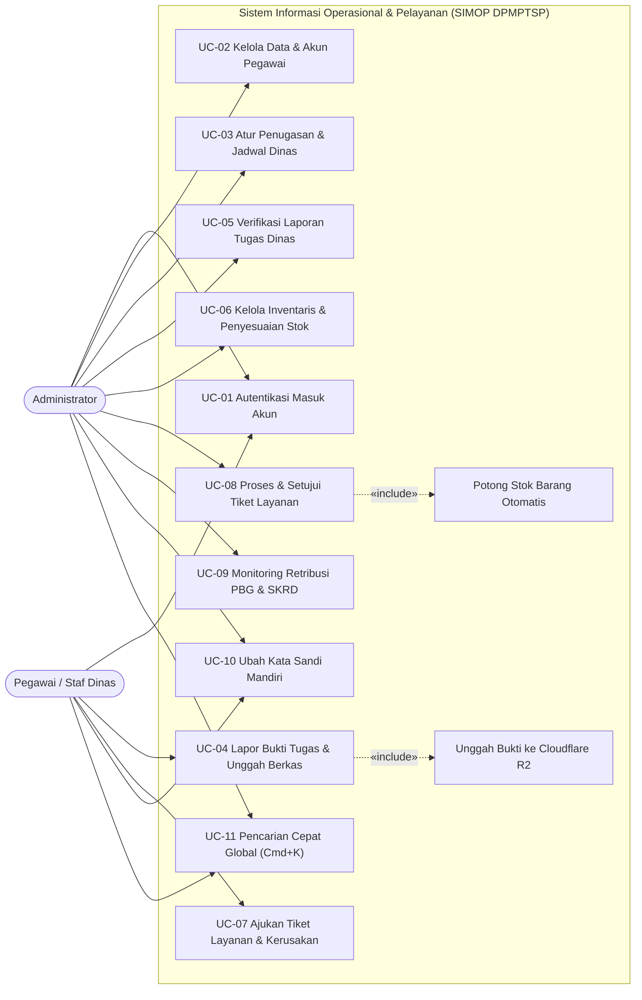
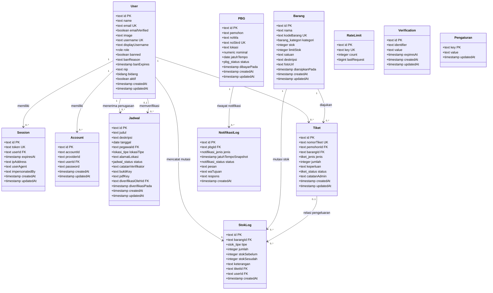
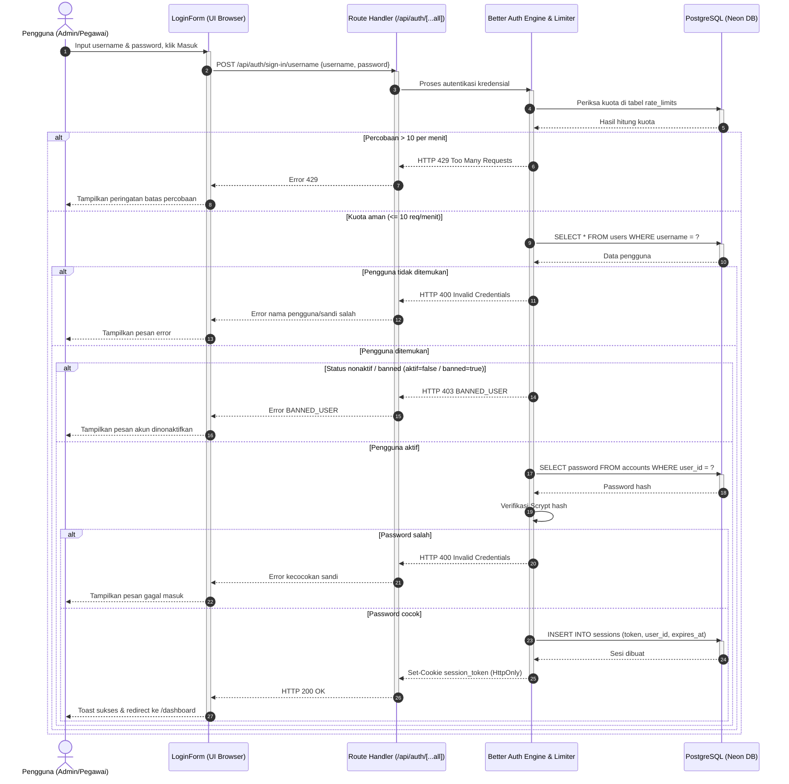
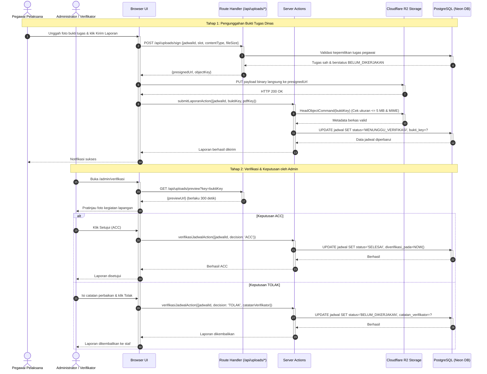
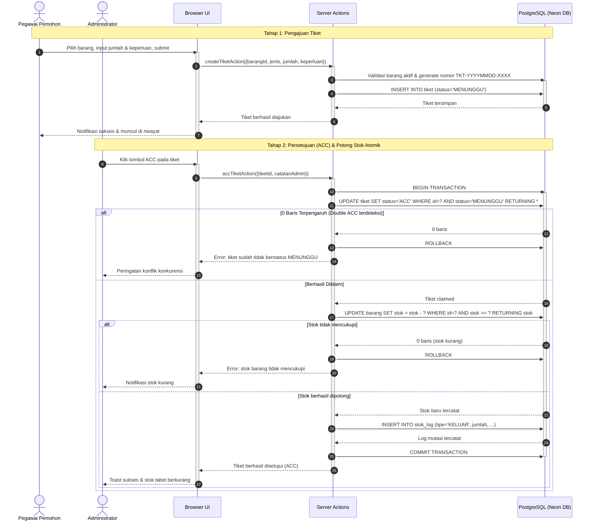
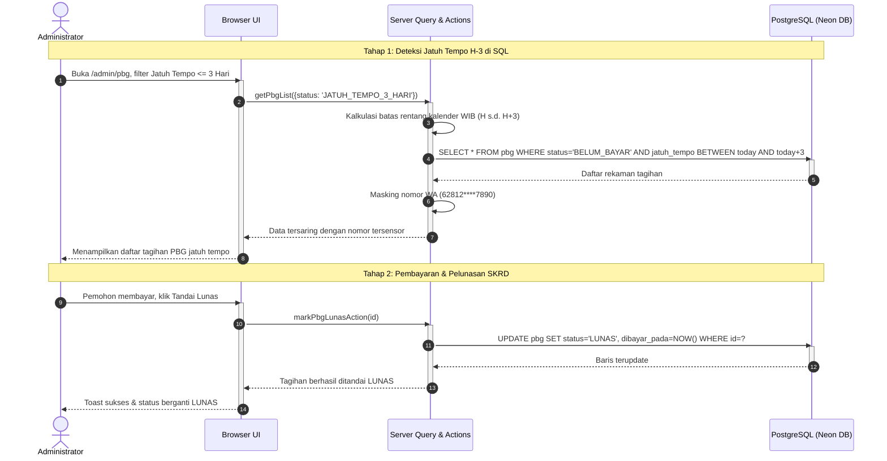
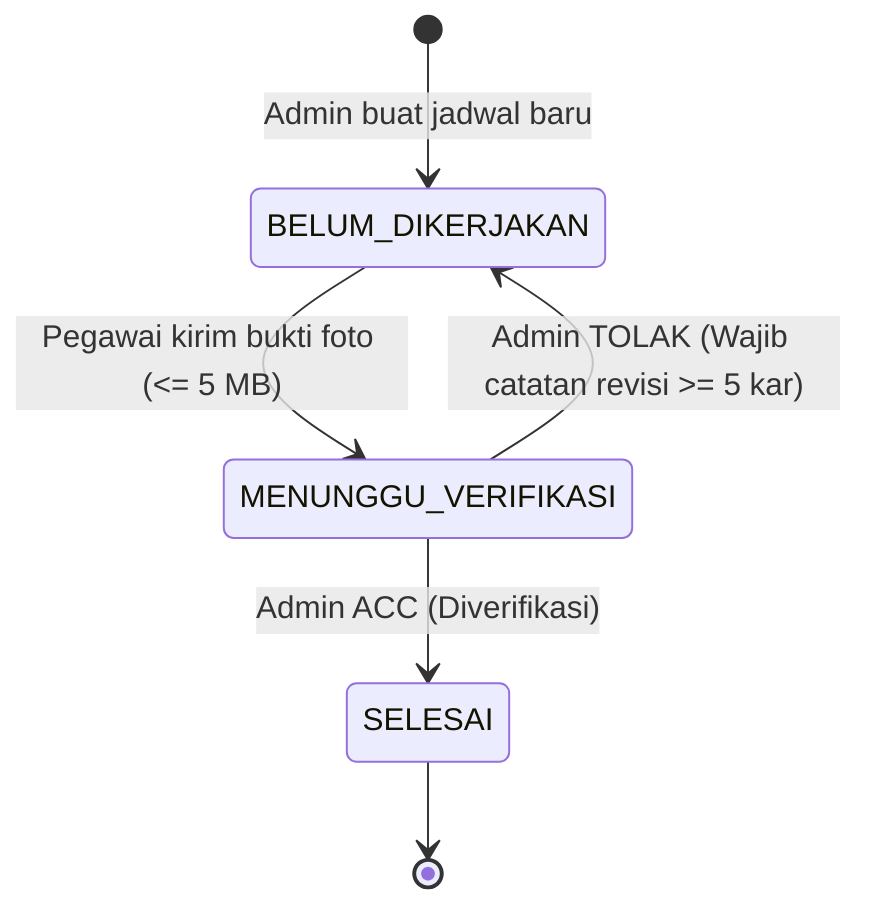
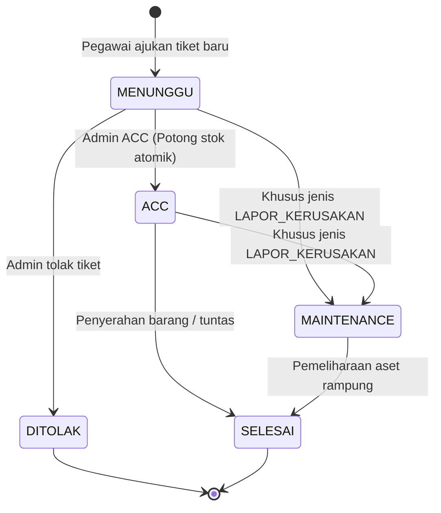
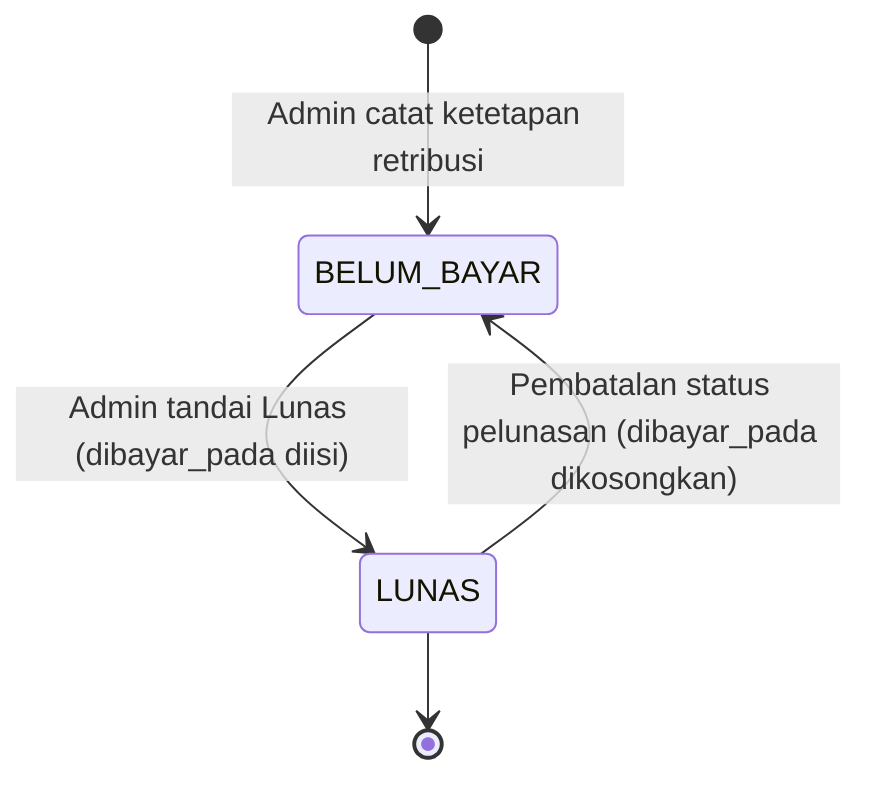

# 4.4 Analisis Kebutuhan dan Perancangan Sistem SIMOP DPMPTSP

Subbab ini menguraikan hasil analisis kebutuhan sistem serta perancangan perangkat lunak untuk Sistem Informasi Operasional dan Pelayanan (SIMOP) Dinas Penanaman Modal dan Pelayanan Terpadu Satu Pintu (DPMPTSP) Kabupaten Karawang. Seluruh perancangan, spesifikasi kebutuhan, diagram pemodelan *Unified Modeling Language* (UML), kamus data, dan matriks keterlacakan diturunkan secara langsung (*reverse engineering*) dari basis kode sumber (*source code*) yang terimplementasi di repositori proyek.

---

## 4.4.1 Kebutuhan Fungsional (*Functional Requirements*)

Kebutuhan fungsional mendefinisikan kapabilitas, layanan, dan operasi bisnis nyata yang disediakan oleh perangkat lunak SIMOP DPMPTSP bagi pengguna aparatur dinas sesuai dengan peran hak akses masing-masing.

Berdasarkan hasil penelusuran terhadap implementasi *Server Actions*, *Route Handlers*, skema validasi Zod, dan antarmuka pengguna Next.js, disusun daftar kebutuhan fungsional sistem seperti yang disajikan pada Tabel 4.8.

**Tabel 4.8** Daftar Kebutuhan Fungsional (*Functional Requirements*) SIMOP DPMPTSP
| ID Kebutuhan | Nama Kebutuhan | Aktor / Peran | Deskripsi Operasional Bisnis | Bukti Implementasi (*File:Baris*) | Status Realisasi |
| :--- | :--- | :--- | :--- | :--- | :--- |
| **FR-01** | Autentikasi Masuk Akun (*Sign-In*) | Admin, Pegawai | Pengguna masuk ke sistem menggunakan nama pengguna (*username*) dan kata sandi dengan validasi pembatasan laju (*rate limiting*) 10 req/menit dan pembentukan cookie sesi HTTP-only. | [src/app/api/auth/[...all]/route.ts:4](file:///c:/Users/DELL%203420/Documents/jun/KP-SIMOP/src/app/api/auth/%5B...all%5D/route.ts#L4), [src/modules/auth/components/LoginForm.tsx:32-53](file:///c:/Users/DELL%203420/Documents/jun/KP-SIMOP/src/modules/auth/components/LoginForm.tsx#L32-L53), [src/lib/auth.ts:77-92](file:///c:/Users/DELL%203420/Documents/jun/KP-SIMOP/src/lib/auth.ts#L77-L92) | Lengkap |
| **FR-02** | Terminasi Sesi Pengguna (*Sign-Out*) | Admin, Pegawai | Pengguna mengakhiri sesi aktif, mencabut token sesi dari peramban dan server, serta diarahkan kembali ke halaman login. | [src/components/layout/AppShell.tsx:70-81](file:///c:/Users/DELL%203420/Documents/jun/KP-SIMOP/src/components/layout/AppShell.tsx#L70-L81), [src/components/layout/SidebarUserCard.tsx:106-118](file:///c:/Users/DELL%203420/Documents/jun/KP-SIMOP/src/components/layout/SidebarUserCard.tsx#L106-L118) | Lengkap |
| **FR-03** | Pendaftaran Akun Staf Pegawai | Admin | Administrator mendaftarkan aparatur baru, menetapkan nama, username unik, password (minimal 8 karakter), NIP, bidang dinas, serta mengenerate email sintetis `@simop.local`. | [src/modules/pegawai/actions.ts:20-64](file:///c:/Users/DELL%203420/Documents/jun/KP-SIMOP/src/modules/pegawai/actions.ts#L20-L64), [src/modules/pegawai/schema.ts:3-16](file:///c:/Users/DELL%203420/Documents/jun/KP-SIMOP/src/modules/pegawai/schema.ts#L3-L16) | Lengkap |
| **FR-04** | Pembaruan Profil Aparatur oleh Admin | Admin | Administrator memperbarui nama lengkap, penugasan bidang dinas, dan nomor NIP pegawai yang terdaftar. | [src/modules/pegawai/actions.ts:66-83](file:///c:/Users/DELL%203420/Documents/jun/KP-SIMOP/src/modules/pegawai/actions.ts#L66-L83), [src/modules/pegawai/schema.ts:18-23](file:///c:/Users/DELL%203420/Documents/jun/KP-SIMOP/src/modules/pegawai/schema.ts#L18-L23) | Lengkap |
| **FR-05** | Pengubahan Status Keaktifan Akun (*Toggle* Aktif/Nonaktif) | Admin | Administrator menonaktifkan akun aparatur secara aman (mengubah status `aktif = false`, `banned = true`, mencatat alasan) serta mencabut seluruh sesi aktif seketika dari basis data. | [src/modules/pegawai/actions.ts:107-119](file:///c:/Users/DELL%203420/Documents/jun/KP-SIMOP/src/modules/pegawai/actions.ts#L107-L119), [src/lib/user-management.ts:22-81](file:///c:/Users/DELL%203420/Documents/jun/KP-SIMOP/src/lib/user-management.ts#L22-L81) | Lengkap |
| **FR-06** | Reset Kata Sandi Akun Pegawai oleh Admin | Admin | Administrator mereset kata sandi staf pegawai dan secara otomatis membatalkan seluruh sesi aktif pegawai terkait demi keamanan. | [src/modules/pegawai/actions.ts:85-105](file:///c:/Users/DELL%203420/Documents/jun/KP-SIMOP/src/modules/pegawai/actions.ts#L85-L105), [src/modules/pegawai/schema.ts:25-28](file:///c:/Users/DELL%203420/Documents/jun/KP-SIMOP/src/modules/pegawai/schema.ts#L25-L28) | Lengkap |
| **FR-07** | Pembuatan Penugasan Jadwal Kedinasan Rentang Tanggal | Admin | Administrator membuat jadwal tugas untuk satu atau banyak pegawai sekaligus pada rentang tanggal tertentu (maksimal 31 hari) dengan opsi melompati akhir pekan. | [src/modules/jadwal/actions.ts:27-69](file:///c:/Users/DELL%203420/Documents/jun/KP-SIMOP/src/modules/jadwal/actions.ts#L27-L69), [src/modules/jadwal/lib/generator.ts:32-99](file:///c:/Users/DELL%203420/Documents/jun/KP-SIMOP/src/modules/jadwal/lib/generator.ts#L32-L99) | Lengkap |
| **FR-08** | Penghapusan Penugasan Jadwal Dinas | Admin | Administrator menghapus jadwal tugas yang belum diverifikasi selesai, disertai pembersihan objek berkas bukti terkait di Cloudflare R2 secara otomatis. | [src/modules/jadwal/actions.ts:76-120](file:///c:/Users/DELL%203420/Documents/jun/KP-SIMOP/src/modules/jadwal/actions.ts#L76-L120) | Lengkap |
| **FR-09** | Pelaporan Bukti Pelaksanaan Tugas oleh Pegawai | Pegawai | Pegawai mengunggah foto bukti kegiatan lapangan (wajib, maks 5 MB) dan dokumen pendukung PDF (opsional) melalui Presigned URL R2, lalu menyerahkan laporan tugas dinas. | [src/app/api/uploads/sign/route.ts:19-100](file:///c:/Users/DELL%203420/Documents/jun/KP-SIMOP/src/app/api/uploads/sign/route.ts#L19-L100), [src/modules/jadwal/actions.ts:126-197](file:///c:/Users/DELL%203420/Documents/jun/KP-SIMOP/src/modules/jadwal/actions.ts#L126-L197), [src/lib/storage.ts:113-171](file:///c:/Users/DELL%203420/Documents/jun/KP-SIMOP/src/lib/storage.ts#L113-L171) | Lengkap |
| **FR-10** | Verifikasi Laporan Tugas Kedinasan | Admin | Administrator meninjau berkas bukti tugas dinas (pratinjau R2 300 detik) dan memberikan keputusan: ACC (status menjadi `SELESAI`) atau TOLAK (status kembali ke `BELUM_DIKERJAKAN` dengan catatan revisi wajib $\ge 5$ karakter). | [src/modules/verifikasi/actions.ts:16-90](file:///c:/Users/DELL%203420/Documents/jun/KP-SIMOP/src/modules/verifikasi/actions.ts#L16-L90), [src/app/api/uploads/preview/route.ts:8-77](file:///c:/Users/DELL%203420/Documents/jun/KP-SIMOP/src/app/api/uploads/preview/route.ts#L8-L77), [src/modules/verifikasi/schema.ts:3-25](file:///c:/Users/DELL%203420/Documents/jun/KP-SIMOP/src/modules/verifikasi/schema.ts#L3-L25) | Lengkap |
| **FR-11** | Manajemen Katalog Barang Inventaris (CRUD & Arsip) | Admin | Administrator mengelola item ATK dan aset sarana dinas, kode barang unik otomatis, pengarsipan aman (*soft-archive*) jika ada riwayat transaksi, atau pemulihan barang arsip. | [src/modules/inventaris/actions.ts:21-62](file:///c:/Users/DELL%203420/Documents/jun/KP-SIMOP/src/modules/inventaris/actions.ts#L21-L62), [src/modules/inventaris/actions.ts:186-280](file:///c:/Users/DELL%203420/Documents/jun/KP-SIMOP/src/modules/inventaris/actions.ts#L186-L280) | Lengkap |
| **FR-12** | Penyesuaian Kuantitas Stok Fisik Barang | Admin | Administrator melakukan penyesuaian kuantitas persediaan barang (MASUK atau KELUAR) dalam transaksi atomik dengan pencatatan otomatis pada log audit persediaan (`stok_log`). | [src/modules/inventaris/actions.ts:93-179](file:///c:/Users/DELL%203420/Documents/jun/KP-SIMOP/src/modules/inventaris/actions.ts#L93-L179), [src/modules/inventaris/schema.ts:26-33](file:///c:/Users/DELL%203420/Documents/jun/KP-SIMOP/src/modules/inventaris/schema.ts#L26-L33) | Lengkap |
| **FR-13** | Pengajuan Tiket Layanan Barang dan Kerusakan | Pegawai | Pegawai mengajukan tiket mandiri untuk permohonan ATK/barang perlengkapan atau pelaporan kerusakan aset kantor dengan nomor tiket terstandar `TKT-YYYYMMDD-XXXX`. | [src/modules/tiket/actions.ts:20-69](file:///c:/Users/DELL%203420/Documents/jun/KP-SIMOP/src/modules/tiket/actions.ts#L20-L69), [src/modules/tiket/schema.ts:3-10](file:///c:/Users/DELL%203420/Documents/jun/KP-SIMOP/src/modules/tiket/schema.ts#L3-L10) | Lengkap |
| **FR-14** | Persetujuan (ACC) Tiket dengan Pemotongan Stok Atomik | Admin | Administrator menyetujui tiket; sistem mengklaim status tiket menjadi `ACC` secara atomik (mencegah *double approval*) dan secara otomatis memotong stok barang terkait pada tiket permohonan barang. | [src/modules/tiket/actions.ts:81-164](file:///c:/Users/DELL%203420/Documents/jun/KP-SIMOP/src/modules/tiket/actions.ts#L81-L164), [src/db/schema/domain.ts:71](file:///c:/Users/DELL%203420/Documents/jun/KP-SIMOP/src/db/schema/domain.ts#L71) | Lengkap |
| **FR-15** | Pembaruan Status Penanganan Lanjutan Tiket Layanan | Admin | Administrator memperbarui status tiket layanan menjadi `MAINTENANCE` (khusus laporan kerusakan), `DITOLAK`, atau `SELESAI` disertai catatan tindak lanjut dinas. | [src/modules/tiket/actions.ts:169-216](file:///c:/Users/DELL%203420/Documents/jun/KP-SIMOP/src/modules/tiket/actions.ts#L169-L216), [src/modules/tiket/lib/transitions.ts:17-71](file:///c:/Users/DELL%203420/Documents/jun/KP-SIMOP/src/modules/tiket/lib/transitions.ts#L17-L71) | Lengkap |
| **FR-16** | Pencatatan Ketetapan Retribusi PBG & Validasi SKRD | Admin | Administrator mencatat ketetapan retribusi Persetujuan Bangunan Gedung (PBG), menormalisasi nomor kontak WhatsApp pemohon (`628xxx`), dan memastikan keunikan nomor SKRD. | [src/modules/pbg/actions.ts:19-55](file:///c:/Users/DELL%203420/Documents/jun/KP-SIMOP/src/modules/pbg/actions.ts#L19-L55), [src/modules/pbg/schema.ts:23-58](file:///c:/Users/DELL%203420/Documents/jun/KP-SIMOP/src/modules/pbg/schema.ts#L23-L58) | Lengkap |
| **FR-17** | Monitoring Pelunasan SKRD & Deteksi Jatuh Tempo H-3 | Admin | Administrator memantau tagihan retribusi yang mendekati jatuh tempo ($\le 3$ hari dalam zona waktu WIB), menyensor nomor kontak publik, dan menandai status pelunasan pembayaran (`LUNAS`). | [src/modules/pbg/queries.ts:21-121](file:///c:/Users/DELL%203420/Documents/jun/KP-SIMOP/src/modules/pbg/queries.ts#L21-L121), [src/modules/pbg/actions.ts:102-182](file:///c:/Users/DELL%203420/Documents/jun/KP-SIMOP/src/modules/pbg/actions.ts#L102-L182) | Lengkap |
| **FR-18** | Perubahan Kata Sandi Mandiri Aparatur | Admin, Pegawai | Pengguna mengubah kata sandi akun secara mandiri dengan validasi kecocokan sandi lama dan otomatis mencabut sesi aktif pada perangkat lain (*revoke other sessions*). | [src/modules/profil/actions.ts:8-40](file:///c:/Users/DELL%203420/Documents/jun/KP-SIMOP/src/modules/profil/actions.ts#L8-L40), [src/modules/profil/schema.ts:3-17](file:///c:/Users/DELL%203420/Documents/jun/KP-SIMOP/src/modules/profil/schema.ts#L3-L17) | Lengkap |
| **FR-19** | Pencarian Cepat Global Terisolasi Peran (Cmd+K) | Admin, Pegawai | Pengguna melakukan pencarian lintas entitas data (maksimal 8 hasil relevan) dengan penyaringan ketat: Admin dapat mencari pegawai, barang, dan PBG; Pegawai hanya dapat mencari jadwal tugas sendiri dan barang aktif. | [src/modules/search/actions.ts:26-192](file:///c:/Users/DELL%203420/Documents/jun/KP-SIMOP/src/modules/search/actions.ts#L26-L192), [src/components/shared/CommandMenu.tsx:1-120](file:///c:/Users/DELL%203420/Documents/jun/KP-SIMOP/src/components/shared/CommandMenu.tsx#L1-L120) | Lengkap |
| **FR-20** | Visualisasi Kinerja Operasional pada Dashboard Terpadu | Admin, Pegawai | Menyajikan statistik harian: Donut Chart distribusi tugas 4 tipe lokasi & alert operasional untuk Admin; ringkasan tugas mingguan berstandar WIB & Progress Ring untuk Pegawai. | [src/modules/dashboard/queries.ts:60-239](file:///c:/Users/DELL%203420/Documents/jun/KP-SIMOP/src/modules/dashboard/queries.ts#L60-L239), [src/app/(app)/dashboard/page.tsx:16-43](file:///c:/Users/DELL%203420/Documents/jun/KP-SIMOP/src/app/(app)/dashboard/page.tsx#L16-L43) | Lengkap |

Tabel 4.8 memperlihatkan 20 butir kebutuhan fungsional nyata yang seluruhnya didukung oleh baris kode konkret pada sistem SIMOP DPMPTSP. Analisis ini membuktikan beberapa fakta penting:
1. **CRUD Katalog Barang & Penyesuaian Stok (FR-11 & FR-12)**: Terbukti lengkap di kode sumber melalui `createBarangAction`, `updateBarangAction`, `adjustStokAction`, dan `deleteOrArchiveBarangAction`.
2. **Pemotongan Stok Otomatis Saat ACC Tiket (FR-14)**: Terbukti nyata pada `src/modules/tiket/actions.ts:112-149`. Pemotongan kuantitas stok di tabel `barang` dan pencatatan riwayat `stok_log` dieksekusi secara atomik dalam satu transaksi SQL (`db.transaction()`).
3. **Pengiriman WhatsApp Otomatis**: TIDAK DITEMUKAN DI KODE / `[DITANGGUHKAN SEMENTARA DI FASE 4]` berdasarkan catatan keputusan arsitektur [docs/DECISIONS.md:121-128](file:///c:/Users/DELL%203420/Documents/jun/KP-SIMOP/docs/DECISIONS.md#L121-L128). Oleh sebab itu, pengiriman pesan WhatsApp otomatis tidak dicantumkan sebagai kebutuhan fungsional yang aktif.
4. **Hapus Data Pegawai**: Sistem TIDAK MENYEDIAKAN fungsi *hard delete* untuk pegawai guna menjaga keutuhan riwayat tugas dan audit tiket. Pengelolaan status dilakukan melalui penonaktifan atomik akun (`togglePegawaiStatusAction`) pada FR-05.

---

## 4.4.2 Kebutuhan Non-Fungsional (*Non-Functional Requirements*)

Kebutuhan non-fungsional menitikberatkan pada atribut kualitas sistem, parameter keamanan informasi, keandalan integritas data, serta kepatuhan antarmuka terhadap standar aksesibilitas web. Seluruh spesifikasi yang dicantumkan hanya bersumber dari konfigurasi nyata kode sumber.

Berikut merupakan daftar kebutuhan non-fungsional perangkat lunak SIMOP DPMPTSP yang disajikan pada Tabel 4.9.

**Tabel 4.9** Daftar Kebutuhan Non-Fungsional (*Non-Functional Requirements*) SIMOP DPMPTSP
| ID NFR | Parameter Kualitas | Spesifikasi Teknis Nyata | Bukti Implementasi (*File:Baris*) | Cara Pengujian yang Realistis |
| :--- | :--- | :--- | :--- | :--- |
| **NFR-01** | Keamanan Autentikasi & Sesi | Autentikasi berbasis Better Auth dengan cookie sesi `HttpOnly`, `SameSite=Lax`, penandatanganan kriptografis `BETTER_AUTH_SECRET`, dan pengecekan keaktifan akun langsung ke basis data (`checkDbActive: true`). | [src/lib/session.ts:36-74](file:///c:/Users/DELL%203420/Documents/jun/KP-SIMOP/src/lib/session.ts#L36-L74), [src/lib/auth.ts:70-76](file:///c:/Users/DELL%203420/Documents/jun/KP-SIMOP/src/lib/auth.ts#L70-L76) | Verifikasi inspeksi header HTTP response pada pengujian `tests/auth.test.ts` dan pemeriksaan cookie di peramban. |
| **NFR-02** | Keamanan Kata Sandi | Hashing kata sandi kredensial menggunakan fungsi Scrypt bawaan Better Auth Crypto (`hashPassword`), serta penolakan kata sandi dengan panjang di bawah 8 karakter. | [src/modules/pegawai/actions.ts:53](file:///c:/Users/DELL%203420/Documents/jun/KP-SIMOP/src/modules/pegawai/actions.ts#L53), [src/modules/pegawai/schema.ts:11](file:///c:/Users/DELL%203420/Documents/jun/KP-SIMOP/src/modules/pegawai/schema.ts#L11), [src/modules/profil/schema.ts:6](file:///c:/Users/DELL%203420/Documents/jun/KP-SIMOP/src/modules/profil/schema.ts#L6) | Uji validasi unit formulir pembuatan akun dan ubah kata sandi dengan payload input $< 8$ karakter. |
| **NFR-03** | Pembatasan Laju Akses (*Rate Limiting*) | Pembatasan laju percobaan masuk maksimal 10 request per menit per alamat IP pada endpoint login (`/sign-in/username` dan `/sign-in/email`) yang dicatat persisten di tabel basis data `rate_limits`. | [src/lib/auth.ts:77-92](file:///c:/Users/DELL%203420/Documents/jun/KP-SIMOP/src/lib/auth.ts#L77-L92), [src/db/schema/auth.ts:72-79](file:///c:/Users/DELL%203420/Documents/jun/KP-SIMOP/src/db/schema/auth.ts#L72-L79) | Menjalankan *script* perulangan 11 kali percobaan login cepat dan memverifikasi balikan HTTP status 429. |
| **NFR-04** | Otorisasi Hak Akses Peran (*RBAC*) | Penegakan kontrol akses berbasis peran (`ADMIN` dan `PEGAWAI`) pada tingkat tata kelola layout dan Server Actions; akses ilegal ke endpoint administratif menghasilkan penolakan instan. | [src/app/(app)/admin/layout.tsx:18-27](file:///c:/Users/DELL%203420/Documents/jun/KP-SIMOP/src/app/(app)/admin/layout.tsx#L18-L27), [src/lib/session.ts:66-68](file:///c:/Users/DELL%203420/Documents/jun/KP-SIMOP/src/lib/session.ts#L66-L68) | Pengujian otomatis `tests/auth.test.ts` memverifikasi peran `PEGAWAI` ditolak HTTP 403 saat memanggil aksi khusus Admin. |
| **NFR-05** | Keamanan Berkas & Pembatasan Kuota | Berkas bukti kegiatan ditampung di bucket privat Cloudflare R2 dengan URL presigned berumur pendek (300 detik), pembatasan ukuran maksimal 5 MB, dan verifikasi integritas MIME ganda melalui `HeadObjectCommand`. | [src/lib/storage.ts:40-48](file:///c:/Users/DELL%203420/Documents/jun/KP-SIMOP/src/lib/storage.ts#L40-L48), [src/lib/storage.ts:110-170](file:///c:/Users/DELL%203420/Documents/jun/KP-SIMOP/src/lib/storage.ts#L110-L170), [src/app/api/uploads/sign/route.ts:13-17](file:///c:/Users/DELL%203420/Documents/jun/KP-SIMOP/src/app/api/uploads/sign/route.ts#L13-L17) | Pengujian `tests/storage-and-verifikasi.test.ts` memverifikasi penolakan berkas $> 5$ MB dan format selain JPEG/PNG/WebP/PDF. |
| **NFR-06** | Keamanan Header Jaringan & CSP | Penerapan Content-Security-Policy tanpa `'unsafe-eval'` di lingkungan produksi, pembatasan koneksi host presisi ke domain Cloudflare R2, serta penetapan header `X-Frame-Options: DENY`, `X-Content-Type-Options: nosniff`, dan pembatasan izin piranti. | [next.config.ts:21-69](file:///c:/Users/DELL%203420/Documents/jun/KP-SIMOP/next.config.ts#L21-L69), [src/lib/auth.ts:36-62](file:///c:/Users/DELL%203420/Documents/jun/KP-SIMOP/src/lib/auth.ts#L36-L62) | Memeriksa kecocokan header keamanan HTTP pada *response headers* lingkungan produksi atau staging. |
| **NFR-07** | Aksesibilitas Kontras Warna (WCAG AA & AAA) | Seluruh pasangan token warna teks dan latar belakang pada tema terang maupun gelap memenuhi rasio kontras W3C WCAG 2.1 minimal 4.5:1 untuk teks normal dan 3.0:1 untuk elemen grafis. | [scripts/contrast.mjs:1-180](file:///c:/Users/DELL%203420/Documents/jun/KP-SIMOP/scripts/contrast.mjs#L1-L180), [src/styles/globals.css:6-140](file:///c:/Users/DELL%203420/Documents/jun/KP-SIMOP/src/styles/globals.css#L6-L140) | Eksekusi skrip otomasi `pnpm check:contrast` yang menghitung rasio matematis relatif luminansi. |
| **NFR-08** | Integritas Transaksi Atomik Basis Data | Operasi krusial penyesuaian stok, persetujuan tiket, dan penonaktifan akun dieksekusi dalam transaksi atomik PostgreSQL (`db.transaction`) untuk mencegah anomali konkurensi data. | [src/modules/tiket/actions.ts:85-154](file:///c:/Users/DELL%203420/Documents/jun/KP-SIMOP/src/modules/tiket/actions.ts#L85-L154), [src/lib/user-management.ts:31-80](file:///c:/Users/DELL%203420/Documents/jun/KP-SIMOP/src/lib/user-management.ts#L31-L80) | Pengujian `tests/tiket-concurrency.test.ts` mengeksekusi dua permintaan ACC bersamaan (`Promise.all`) untuk membuktikan stok terpotong tepat satu kali. |
| **NFR-09** | Validasi Masukan Waktu Nyata (*Runtime Validation*) | Seluruh payload data masukan dari klien divalidasi secara ketat menggunakan pustaka Zod sebelum data diproses oleh logika bisnis atau disimpan ke basis data. | [src/modules/pbg/schema.ts:23-58](file:///c:/Users/DELL%203420/Documents/jun/KP-SIMOP/src/modules/pbg/schema.ts#L23-L58), [src/modules/inventaris/schema.ts:3-33](file:///c:/Users/DELL%203420/Documents/jun/KP-SIMOP/src/modules/inventaris/schema.ts#L3-L33) | Menjalankan unit test skema Zod dengan memasukkan data string kosong, tipe data salah, atau nilai negatif. |

Tabel 4.9 menetapkan batasan kualitas sistem yang objektif dan terukur. Terkait parameter kinerja (*performance*), waktu respons absolut (seperti ambang batas $< 2$ detik) **tidak ditetapkan di kode**, karena performa aktual di lingkungan *cloud serverless* sangat dipengaruhi oleh latensi jaringan penyedia infrastruktur Neon PostgreSQL dan Vercel Edge Network.

---

## 4.4.3 Perancangan Pemodelan UML

Pemodelan berorientasi objek sistem SIMOP DPMPTSP digambarkan menggunakan notasi *Unified Modeling Language* (UML) [PERLU SITASI: standar UML Dennis dkk] yang mencakup *Use Case Diagram*, *Class Diagram*, *Sequence Diagram*, dan *State Machine Diagram*.

### 4.4.3.1 Use Case Diagram

*Use Case Diagram* menyajikan interaksi fungsional antara aktor pengguna dengan sistem SIMOP DPMPTSP. Berdasarkan hasil verifikasi kode sumber, teridentifikasi 2 (dua) aktor utama manusia yang berinteraksi dengan sistem, yaitu:
1. **Administrator (Admin)**: Aparatur dinas yang memiliki wewenang penuh dalam mengelola data kepegawaian, membuat jadwal penugasan kedinasan, memverifikasi bukti pelaksanaan tugas, mengelola inventaris aset/ATK, memproses tiket layanan permohonan sarana, dan mengontrol ketetapan retribusi PBG.
2. **Pegawai (Staf Dinas)**: Aparatur pelaksana yang memiliki hak akses terbatas untuk melihat linimasa jadwal tugas mandiri, mengunggah bukti foto lapangan, mengajukan tiket layanan barang/kerusakan, memantau riwayat tiket, dan mengubah kata sandi akun secara mandiri.

Aktor sistem otomatis (*Cron Scheduler*) **tidak disertakan** sebagai aktor aktif karena rute cron dan layanan pengingat otomatis WhatsApp berada pada status ditangguhkan sementara (`[DITANGGUHKAN SEMENTARA DI FASE 4]`).

Berikut merupakan visualisasi *Use Case Diagram* sistem SIMOP DPMPTSP yang disajikan pada Gambar 4.1.

**Gambar 4.1** *Use Case Diagram* Sistem SIMOP DPMPTSP Kabupaten Karawang  
*(Kode sumber berkas diagram mandiri tersimpan di `docs/bab4/diagram/use-case.puml` dan `docs/bab4/diagram/use-case.mmd`)*

Gambar 4.1 mendeskripsikan 11 *use case* utama dan 2 *use case* relasi `<<include>>`:
- Relasi `<<include>>` dari UC-04 ke *Unggah Bukti ke Cloudflare R2* terjadi karena proses penyerahan laporan tugas dinas secara mutlak mewajibkan adanya berkas foto bukti kegiatan yang diunggah langsung ke penyimpanan Cloudflare R2 melalui presigned URL.
- Relasi `<<include>>` dari UC-08 ke *Potong Stok Barang Otomatis* terjadi karena aksi persetujuan (ACC) pada tiket bertipe permohonan barang secara inheren memicu pemotongan kuantitas stok barang dan pencatatan audit pada log persediaan dalam satu transaksi basis data.

Rincian spesifikasi naratif dan interaksi stimulus-respon dari masing-masing *use case* dijabarkan pada subbagian berikut:

---

#### 1. UC-01: Autentikasi Masuk Akun (*Sign-In*)

Berikut merupakan spesifikasi *use case* UC-01 yang disajikan pada Tabel 4.10.

**Tabel 4.10** Spesifikasi Use Case UC-01 (Autentikasi Masuk Akun)
| Elemen Use Case | Deskripsi Rinci |
| :--- | :--- |
| **ID & Nama Use Case** | UC-01: Autentikasi Masuk Akun (*Sign-In*) |
| **Aktor** | Administrator, Pegawai |
| **Deskripsi** | Pengguna aparatur melakukan autentikasi ke dalam sistem menggunakan nama pengguna dan kata sandi untuk memperoleh sesi kerja terotorisasi. |
| **Kebutuhan Terkait** | FR-01, NFR-01, NFR-02, NFR-03 |
| **Prakondisi** | Pengguna telah terdaftar di sistem dengan status aktif (`aktif = true` dan `banned = false`), serta peramban web menampilkan halaman `/login`. |
| **Pascakondisi** | Cookie sesi HTTP-only tersimpan di peramban, rekaman sesi tersimpan di tabel `sessions`, dan pengguna dialihkan ke halaman `/dashboard`. |

Berikut merupakan alur interaksi stimulus-respon dari UC-01 yang disajikan pada Tabel 4.11.

**Tabel 4.11** Stimulus-Respon UC-01 (Autentikasi Masuk Akun)
| No | Aktor (Stimulus) | Sistem (Respon) | Bukti Kode Sumber (*File:Baris*) |
| :---: | :--- | :--- | :--- |
| 1 | Pengguna memasukkan *username* dan *password*, lalu menekan tombol "Masuk ke Sistem". | Sistem memeriksa kuota percobaan pada tabel `rate_limits`. Jika $\le 10$ req/menit, sistem mencari akun di tabel `users`. | [src/modules/auth/components/LoginForm.tsx:32](file:///c:/Users/DELL%203420/Documents/jun/KP-SIMOP/src/modules/auth/components/LoginForm.tsx#L32), [src/lib/auth.ts:83-87](file:///c:/Users/DELL%203420/Documents/jun/KP-SIMOP/src/lib/auth.ts#L83-L87) |
| 2 | - | Sistem memverifikasi hash kata sandi Scrypt pada tabel `accounts`. Jika valid, sistem membuat sesi di tabel `sessions`, menyuntikkan cookie sesi `HttpOnly`, dan menampilkan pesan sukses. | [src/lib/auth.ts:141-154](file:///c:/Users/DELL%203420/Documents/jun/KP-SIMOP/src/lib/auth.ts#L141-L154), [src/modules/auth/components/LoginForm.tsx:51](file:///c:/Users/DELL%203420/Documents/jun/KP-SIMOP/src/modules/auth/components/LoginForm.tsx#L51) |
| 3 | - | Sistem mengarahkan pengguna secara otomatis ke halaman `/dashboard`. | [src/modules/auth/components/LoginForm.tsx:52](file:///c:/Users/DELL%203420/Documents/jun/KP-SIMOP/src/modules/auth/components/LoginForm.tsx#L52) |
| **Alur Alternatif 1a** | Pengguna melakukan percobaan login $> 10$ kali dalam 1 menit. | Sistem menolak permintaan dengan balikan HTTP 429 dan menampilkan pesan: "Terlalu banyak percobaan masuk. Mohon tunggu beberapa saat." | [src/modules/auth/components/LoginForm.tsx:43-44](file:///c:/Users/DELL%203420/Documents/jun/KP-SIMOP/src/modules/auth/components/LoginForm.tsx#L43-L44) |
| **Alur Alternatif 1b** | Kredensial tidak cocok atau akun tidak ditemukan. | Sistem menolak dengan kode HTTP 400 dan menampilkan pesan: "Nama pengguna atau kata sandi tidak cocok." | [src/modules/auth/components/LoginForm.tsx:46](file:///c:/Users/DELL%203420/Documents/jun/KP-SIMOP/src/modules/auth/components/LoginForm.tsx#L46) |
| **Alur Alternatif 1c** | Akun pengguna berstatus nonaktif atau diblokir (`banned = true`). | Sistem membatalkan login dengan kode error `BANNED_USER` dan menampilkan: "Akun Anda dinonaktifkan atau diblokir. Silakan hubungi administrator dinas." | [src/modules/auth/components/LoginForm.tsx:41-42](file:///c:/Users/DELL%203420/Documents/jun/KP-SIMOP/src/modules/auth/components/LoginForm.tsx#L41-L42) |

Pada Tabel 4.11 terlihat bahwa alur autentikasi telah memitigasi risiko serangan *brute force* secara berlapis di tingkat mesin basis data melalui tabel `rate_limits`, sekaligus mengisolasi akun yang dinonaktifkan tanpa memberi celah bypass sesi cookie.

---

#### 2. UC-02: Kelola Data & Akun Pegawai

Berikut merupakan spesifikasi *use case* UC-02 yang disajikan pada Tabel 4.12.

**Tabel 4.12** Spesifikasi Use Case UC-02 (Manajemen Akun Aparatur Pegawai)
| Elemen Use Case | Deskripsi Rinci |
| :--- | :--- |
| **ID & Nama Use Case** | UC-02: Kelola Data & Akun Pegawai |
| **Aktor** | Administrator |
| **Deskripsi** | Administrator mendaftarkan staf pegawai dinas baru, memperbarui penugasan bidang dinas, menonaktifkan akun aparatur, dan melakukan reset kata sandi. |
| **Kebutuhan Terkait** | FR-03, FR-04, FR-05, FR-06 |
| **Prakondisi** | Administrator telah terautentikasi dengan hak akses `role = 'ADMIN'` dan membuka menu `/admin/pegawai`. |
| **Pascakondisi** | Data pegawai bertambah, diperbarui, atau akun diubah status keaktifannya pada tabel `users` dan `accounts`. |

Berikut merupakan alur interaksi stimulus-respon dari UC-02 yang disajikan pada Tabel 4.13.

**Tabel 4.13** Stimulus-Respon UC-02 (Manajemen Akun Aparatur Pegawai)
| No | Aktor (Stimulus) | Sistem (Respon) | Bukti Kode Sumber (*File:Baris*) |
| :---: | :--- | :--- | :--- |
| 1 | Administrator menekan tombol "Tambah Pegawai", mengisi formulir (nama, username, sandi, bidang dinas, NIP), dan menekan tombol simpan. | Sistem mengeksekusi `createPegawaiAction`, memvalidasi skema Zod, memastikan keunikan username, meng-hash sandi, serta menyimpan data ke tabel `users` dan `accounts`. | [src/modules/pegawai/actions.ts:20-64](file:///c:/Users/DELL%203420/Documents/jun/KP-SIMOP/src/modules/pegawai/actions.ts#L20-L64) |
| 2 | - | Sistem memicu `revalidatePath('/admin/pegawai')`, menutup dialog modal, dan menyajikan notifikasi sukses: "Akun pegawai @username berhasil dibuat." | [src/modules/pegawai/actions.ts:62-63](file:///c:/Users/DELL%203420/Documents/jun/KP-SIMOP/src/modules/pegawai/actions.ts#L62-L63) |
| **Alur Alternatif 2a** | Username yang diinput telah digunakan oleh akun lain. | Sistem melempar exception: "Username @username sudah digunakan." Transaksi dibatalkan dan modal tetap terbuka. | [src/modules/pegawai/actions.ts:31-33](file:///c:/Users/DELL%203420/Documents/jun/KP-SIMOP/src/modules/pegawai/actions.ts#L31-L33) |
| **Alur Alternatif 2b** | Administrator memilih aksi "Nonaktifkan Akun" pada baris pegawai. | Sistem mengeksekusi `togglePegawaiStatusAction` $\to$ `deactivateUser`, mengubah `aktif = false`, `banned = true`, dan menghapus seluruh sesi aktif dari tabel `sessions`. | [src/lib/user-management.ts:63-74](file:///c:/Users/DELL%203420/Documents/jun/KP-SIMOP/src/lib/user-management.ts#L63-L74) |
| **Alur Alternatif 2c** | Administrator mencoba menonaktifkan akun dirinya sendiri atau admin aktif terakhir. | Sistem menolak tindakan dengan pesan: "Anda tidak dapat menonaktifkan akun Anda sendiri" atau "Tidak dapat menonaktifkan akun administrator aktif terakhir di sistem." | [src/lib/user-management.ts:27-29](file:///c:/Users/DELL%203420/Documents/jun/KP-SIMOP/src/lib/user-management.ts#L27-L29), [src/lib/user-management.ts:57-59](file:///c:/Users/DELL%203420/Documents/jun/KP-SIMOP/src/lib/user-management.ts#L57-L59) |

Tabel 4.13 memperlihatkan perlindungan integritas akun administratif yang ketat. Sistem secara otomatis menolak upaya penonaktifan terhadap admin aktif terakhir guna mencegah kondisi sistem terkunci tanpa pengelola (*system lockout*).

---

#### 3. UC-03: Atur Penugasan & Jadwal Dinas

Berikut merupakan spesifikasi *use case* UC-03 yang disajikan pada Tabel 4.14.

**Tabel 4.14** Spesifikasi Use Case UC-03 (Pengelolaan dan Penugasan Jadwal Dinas)
| Elemen Use Case | Deskripsi Rinci |
| :--- | :--- |
| **ID & Nama Use Case** | UC-03: Atur Penugasan & Jadwal Dinas |
| **Aktor** | Administrator |
| **Deskripsi** | Administrator menjadwalkan penugasan kerja dinas (loket, kecamatan, kantor, lapangan) untuk aparatur staf menggunakan generator rentang tanggal. |
| **Kebutuhan Terkait** | FR-07, FR-08 |
| **Prakondisi** | Administrator masuk ke sistem dan membuka halaman `/admin/jadwal`. Data aparatur aktif telah terdaftar di sistem. |
| **Pascakondisi** | Baris penugasan tersimpan di tabel `jadwal` dengan kolom `tanggal` kanonikal (YYYY-MM-DD) dan status awal `BELUM_DIKERJAKAN`. |

Berikut merupakan alur interaksi stimulus-respon dari UC-03 yang disajikan pada Tabel 4.15.

**Tabel 4.15** Stimulus-Respon UC-03 (Pengelolaan dan Penugasan Jadwal Dinas)
| No | Aktor (Stimulus) | Sistem (Respon) | Bukti Kode Sumber (*File:Baris*) |
| :---: | :--- | :--- | :--- |
| 1 | Administrator menekan tombol "Buat Jadwal Baru", memilih rentang tanggal mulai-selesai, memilih tipe lokasi penugasan, memilih daftar pegawai pelaksana, dan klik Simpan. | Sistem memanggil `createJadwalRangeAction`, memvalidasi skema `createJadwalRangeSchema`, dan mengeksekusi generator domain `generateJadwalRange`. | [src/modules/jadwal/actions.ts:27-41](file:///c:/Users/DELL%203420/Documents/jun/KP-SIMOP/src/modules/jadwal/actions.ts#L27-L41) |
| 2 | - | Sistem menghasilkan daftar item jadwal harian (melewati Sabtu & Minggu secara default), mengeksekusi *batch insert* ke tabel `jadwal`, dan memperbarui tampilan. | [src/modules/jadwal/actions.ts:48-68](file:///c:/Users/DELL%203420/Documents/jun/KP-SIMOP/src/modules/jadwal/actions.ts#L48-L68), [src/modules/jadwal/lib/generator.ts:74-98](file:///c:/Users/DELL%203420/Documents/jun/KP-SIMOP/src/modules/jadwal/lib/generator.ts#L74-L98) |
| **Alur Alternatif 3a** | Rentang tanggal yang dipilih melebihi 31 hari kalender. | Sistem melempar exception: "Rentang pembuatan jadwal maksimal adalah 31 hari." Data tidak disimpan. | [src/modules/jadwal/lib/generator.ts:68-70](file:///c:/Users/DELL%203420/Documents/jun/KP-SIMOP/src/modules/jadwal/lib/generator.ts#L68-L70) |
| **Alur Alternatif 3b** | Administrator menghapus jadwal yang telah berstatus `SELESAI`. | Sistem melempar exception: "Jadwal penugasan yang telah selesai diverifikasi tidak dapat dihapus." | [src/modules/jadwal/actions.ts:95-97](file:///c:/Users/DELL%203420/Documents/jun/KP-SIMOP/src/modules/jadwal/actions.ts#L95-L97) |

Tabel 4.15 menunjukkan kepatuhan fungsi penjadwalan terhadap integritas data operasional dinas, di mana batas pembuatan jadwal dibatasi maksimal 31 hari untuk menjamin efisiensi ukuran batch transaksi SQL.

---

#### 4. UC-04: Lapor Bukti Tugas & Unggah Berkas

Berikut merupakan spesifikasi *use case* UC-04 yang disajikan pada Tabel 4.16.

**Tabel 4.16** Spesifikasi Use Case UC-04 (Pelaporan Bukti Pelaksanaan Tugas)
| Elemen Use Case | Deskripsi Rinci |
| :--- | :--- |
| **ID & Nama Use Case** | UC-04: Lapor Bukti Tugas & Unggah Berkas |
| **Aktor** | Pegawai |
| **Deskripsi** | Pegawai mengunggah foto bukti kegiatan fisik di lokasi penugasan dan dokumen PDF pendukung ke Cloudflare R2, kemudian menyerahkan laporan pelaksanaan dinas. |
| **Kebutuhan Terkait** | FR-09, NFR-05 |
| **Prakondisi** | Pegawai masuk ke sistem, memiliki jadwal dinas berstatus `BELUM_DIKERJAKAN` pada menu `/pegawai/jadwal`. |
| **Pascakondisi** | Objek berkas tersimpan di bucket privat Cloudflare R2, kolom `buktiKey` dan `pdfKey` terisi, dan status jadwal bertransisi menjadi `MENUNGGU_VERIFIKASI`. |

Berikut merupakan alur interaksi stimulus-respon dari UC-04 yang disajikan pada Tabel 4.17.

**Tabel 4.17** Stimulus-Respon UC-04 (Pelaporan Bukti Pelaksanaan Tugas)
| No | Aktor (Stimulus) | Sistem (Respon) | Bukti Kode Sumber (*File:Baris*) |
| :---: | :--- | :--- | :--- |
| 1 | Pegawai memilih kartu penugasan, melampirkan berkas foto pada dialog "Kirim Laporan". | Klien mengirim `POST /api/uploads/sign`. Sistem memvalidasi wewenang pegawai, format berkas, ukuran $\le 5$ MB, lalu mengembalikan Presigned PUT URL R2. | [src/app/api/uploads/sign/route.ts:19-86](file:///c:/Users/DELL%203420/Documents/jun/KP-SIMOP/src/app/api/uploads/sign/route.ts#L19-L86) |
| 2 | - | Klien mengunggah berkas secara langsung dari peramban ke Cloudflare R2 via HTTP PUT menggunakan Presigned URL yang diterima. | [src/components/shared/FileDropzone.tsx:1-120](file:///c:/Users/DELL%203420/Documents/jun/KP-SIMOP/src/components/shared/FileDropzone.tsx#L1-L120) |
| 3 | Pegawai menekan tombol "Kirim Laporan Tugas". | Klien memanggil Server Action `submitLaporanAction({jadwalId, buktiKey, pdfKey})`. | [src/modules/jadwal/actions.ts:126-130](file:///c:/Users/DELL%203420/Documents/jun/KP-SIMOP/src/modules/jadwal/actions.ts#L126-L130) |
| 4 | - | Sistem mengeksekusi `HeadObjectCommand` ke R2 untuk memverifikasi ukuran $\le 5$ MB dan tipe MIME sah. Jika lolos, sistem mengupdate status jadwal menjadi `MENUNGGU_VERIFIKASI`. | [src/lib/storage.ts:140-164](file:///c:/Users/DELL%203420/Documents/jun/KP-SIMOP/src/lib/storage.ts#L140-L164), [src/modules/jadwal/actions.ts:177-186](file:///c:/Users/DELL%203420/Documents/jun/KP-SIMOP/src/modules/jadwal/actions.ts#L177-L186) |
| **Alur Alternatif 4a** | Pegawai mengunggah berkas yang melebihi batas 5 MB (manipulasi payload sisi klien). | Fungsi `verifyR2Object` mendeteksi pelanggaran, memicu `DeleteObjectCommand` untuk menghapus berkas di R2, dan melempar error: "Ukuran berkas melebihi batas maksimal 5 MB." | [src/lib/storage.ts:150-154](file:///c:/Users/DELL%203420/Documents/jun/KP-SIMOP/src/lib/storage.ts#L150-L154) |
| **Alur Alternatif 4b** | Pegawai mengirim laporan atas jadwal tugas milik pegawai lain. | Sistem melempar exception: "Anda tidak memiliki wewenang untuk melaporkan jadwal tugas ini." Laporan dibatalkan. | [src/modules/jadwal/actions.ts:142-144](file:///c:/Users/DELL%203420/Documents/jun/KP-SIMOP/src/modules/jadwal/actions.ts#L142-L144) |

Tabel 4.17 mendemonstrasikan pertahanan mendalam (*defense-in-depth*) dalam arsitektur penyimpanan berkas SIMOP DPMPTSP, di mana verifikasi integritas objek berkas tetap ditegakkan di sisi server melalui `HeadObjectCommand` sebelum status laporan diakui sah.

---

#### 5. UC-05: Verifikasi Laporan Tugas Dinas

Berikut merupakan spesifikasi *use case* UC-05 yang disajikan pada Tabel 4.18.

**Tabel 4.18** Spesifikasi Use Case UC-05 (Verifikasi Laporan Tugas Kedinasan)
| Elemen Use Case | Deskripsi Rinci |
| :--- | :--- |
| **ID & Nama Use Case** | UC-05: Verifikasi Laporan Tugas Dinas |
| **Aktor** | Administrator / Verifikator |
| **Deskripsi** | Verifikator meninjau berkas foto dan dokumen laporan yang dikirimkan oleh pegawai, lalu menyetujui (ACC) atau menolak laporan disertai catatan perbaikan. |
| **Kebutuhan Terkait** | FR-10 |
| **Prakondisi** | Administrator masuk ke menu `/admin/verifikasi`. Terdapat laporan tugas berstatus `MENUNGGU_VERIFIKASI`. |
| **Pascakondisi** | Status jadwal diperbarui menjadi `SELESAI` (bila di-ACC) atau kembali menjadi `BELUM_DIKERJAKAN` dengan catatan penolakan (bila ditolak). |

Berikut merupakan alur interaksi stimulus-respon dari UC-05 yang disajikan pada Tabel 4.19.

**Tabel 4.19** Stimulus-Respon UC-05 (Verifikasi Laporan Tugas Kedinasan)
| No | Aktor (Stimulus) | Sistem (Respon) | Bukti Kode Sumber (*File:Baris*) |
| :---: | :--- | :--- | :--- |
| 1 | Verifikator membuka kartu antrean verifikasi dan meninjau foto bukti lapangan. | Klien meminta `GET /api/uploads/preview?key=...`. Sistem memvalidasi wewenang verifikator dan menerbitkan URL GET bertanda tangan R2 berumur 300 detik. | [src/app/api/uploads/preview/route.ts:8-70](file:///c:/Users/DELL%203420/Documents/jun/KP-SIMOP/src/app/api/uploads/preview/route.ts#L8-L70) |
| 2 | Verifikator memilih keputusan: klik tombol "Setujui (ACC)". | Klien memicu `verifikasiJadwalAction({jadwalId, decision: 'ACC'})`. Sistem memvalidasi transisi status, mengupdate `status = 'SELESAI'`, mengisi `diverifikasiOlehId`, dan merekam waktu verifikasi. | [src/modules/verifikasi/actions.ts:35-50](file:///c:/Users/DELL%203420/Documents/jun/KP-SIMOP/src/modules/verifikasi/actions.ts#L35-L50) |
| 3 | - | Kartu penugasan hilang dari antrean verifikasi dan muncul notifikasi sukses: "Laporan tugas berhasil disetujui (ACC)." | [src/modules/verifikasi/actions.ts:58-60](file:///c:/Users/DELL%203420/Documents/jun/KP-SIMOP/src/modules/verifikasi/actions.ts#L58-L60) |
| **Alur Alternatif 5a** | Verifikator memutuskan menolak laporan (decision: 'TOLAK') dan mengisi alasan perbaikan. | Sistem memvalidasi bahwa catatan penolakan memiliki panjang minimal 5 karakter, lalu mengupdate `status = 'BELUM_DIKERJAKAN'` dan mencatat `catatanVerifikator`. | [src/modules/verifikasi/schema.ts:16-24](file:///c:/Users/DELL%203420/Documents/jun/KP-SIMOP/src/modules/verifikasi/schema.ts#L16-L24), [src/modules/verifikasi/actions.ts:62-78](file:///c:/Users/DELL%203420/Documents/jun/KP-SIMOP/src/modules/verifikasi/actions.ts#L62-L78) |
| **Alur Alternatif 5b** | Verifikator menolak laporan namun mengosongkan catatan perbaikan ($< 5$ karakter). | Skema Zod menolak aksi dengan pesan kesalahan: "Catatan alasan penolakan wajib diisi (minimal 5 karakter) agar pegawai dapat memperbaiki laporan." | [src/modules/verifikasi/schema.ts:21](file:///c:/Users/DELL%203420/Documents/jun/KP-SIMOP/src/modules/verifikasi/schema.ts#L21) |

Tabel 4.19 memperjelas mekanisme transisi status jadwal dinas di mana penolakan laporan tidak mematikan siklus hidup tugas, melainkan mengembalikan tugas ke status `BELUM_DIKERJAKAN` agar staf aparatur dapat melakukan revisi secara konstruktif sesuai catatan verifikator.

---

#### 6. UC-06: Kelola Inventaris & Penyesuaian Stok

Berikut merupakan spesifikasi *use case* UC-06 yang disajikan pada Tabel 4.20.

**Tabel 4.20** Spesifikasi Use Case UC-06 (Pengelolaan Katalog Inventaris dan Penyesuaian Stok)
| Elemen Use Case | Deskripsi Rinci |
| :--- | :--- |
| **ID & Nama Use Case** | UC-06: Kelola Inventaris & Penyesuaian Stok |
| **Aktor** | Administrator |
| **Deskripsi** | Administrator mengelola item barang ATK/aset dinas, menetapkan batas minimum persediaan, melakukan mutasi penyesuaian stok fisik, serta mengarsipkan barang. |
| **Kebutuhan Terkait** | FR-11, FR-12 |
| **Prakondisi** | Administrator masuk ke sistem dan membuka menu `/admin/inventaris`. |
| **Pascakondisi** | Data katalog barang pada tabel `barang` diperbarui, nilai stok termutasi, dan riwayat tercatat pada tabel `stok_log`. |

Berikut merupakan alur interaksi stimulus-respon dari UC-06 yang disajikan pada Tabel 4.21.

**Tabel 4.21** Stimulus-Respon UC-06 (Pengelolaan Katalog Inventaris dan Penyesuaian Stok)
| No | Aktor (Stimulus) | Sistem (Respon) | Bukti Kode Sumber (*File:Baris*) |
| :---: | :--- | :--- | :--- |
| 1 | Administrator menekan tombol "Tambah Barang", mengisi nama barang, kategori (ATK/ASET), stok awal, batas minimum stok, dan menekan Simpan. | Sistem mengeksekusi `createBarangAction` dalam transaksi atomik, mengenerate kode unik `BRG-XXXXXXXX`, menyimpan barang, dan mencatat log mutasi `MASUK` jika stok awal $> 0$. | [src/modules/inventaris/actions.ts:21-58](file:///c:/Users/DELL%203420/Documents/jun/KP-SIMOP/src/modules/inventaris/actions.ts#L21-L58) |
| 2 | Administrator memilih tombol "Sesuaikan Stok" pada baris barang, memilih tipe (MASUK/KELUAR), memasukkan jumlah mutasi, dan alasan penyesuaian. | Sistem mengeksekusi `adjustStokAction` dalam transaksi SQL: memvalidasi stok tidak menjadi negatif, memutasi nilai kolom `stok`, dan menyisipkan baris baru ke tabel `stok_log`. | [src/modules/inventaris/actions.ts:93-166](file:///c:/Users/DELL%203420/Documents/jun/KP-SIMOP/src/modules/inventaris/actions.ts#L93-L166) |
| **Alur Alternatif 6a** | Nilai mutasi KELUAR melebihi sisa stok yang tersedia di sistem. | Sistem membatalkan transaksi dengan pesan: "Stok saat ini (X) tidak mencukupi untuk pengurangan sebanyak Y." | [src/modules/inventaris/actions.ts:129-131](file:///c:/Users/DELL%203420/Documents/jun/KP-SIMOP/src/modules/inventaris/actions.ts#L129-L131) |
| **Alur Alternatif 6b** | Administrator menghapus barang yang telah memiliki riwayat tiket atau mutasi stok. | Sistem secara otomatis mengalihkan aksi menjadi pengarsipan aman (`diarsipkan_pada = NOW()`) dan menampilkan: "Barang memiliki riwayat transaksi/tiket sehingga berhasil diarsipkan." | [src/modules/inventaris/actions.ts:214-227](file:///c:/Users/DELL%203420/Documents/jun/KP-SIMOP/src/modules/inventaris/actions.ts#L214-L227) |

Tabel 4.21 membuktikan keberadaan logika audit persediaan yang tangguh, di mana setiap pergerakan unit fisik barang tercatat secara kronologis lengkap dengan identitas administrator yang bertanggung jawab.

---

#### 7. UC-07: Ajukan Tiket Layanan & Kerusakan

Berikut merupakan spesifikasi *use case* UC-07 yang disajikan pada Tabel 4.22.

**Tabel 4.22** Spesifikasi Use Case UC-07 (Pengajuan Tiket Layanan Barang dan Kerusakan)
| Elemen Use Case | Deskripsi Rinci |
| :--- | :--- |
| **ID & Nama Use Case** | UC-07: Ajukan Tiket Layanan & Kerusakan |
| **Aktor** | Pegawai |
| **Deskripsi** | Pegawai mengajukan tiket mandiri untuk meminta kebutuhan alat tulis kantor (ATK) atau melaporkan kerusakan sarana aset operasional dinas. |
| **Kebutuhan Terkait** | FR-13 |
| **Prakondisi** | Pegawai masuk ke sistem dan membuka halaman `/pegawai/tiket`. Barang yang diminta berstatus aktif (tidak sedang diarsipkan). |
| **Pascakondisi** | Rekaman tiket baru berstatus `MENUNGGU` tersimpan di tabel `tiket` dengan kode unik `TKT-YYYYMMDD-XXXX`. |

Berikut merupakan alur interaksi stimulus-respon dari UC-07 yang disajikan pada Tabel 4.23.

**Tabel 4.23** Stimulus-Respon UC-07 (Pengajuan Tiket Layanan Barang dan Kerusakan)
| No | Aktor (Stimulus) | Sistem (Respon) | Bukti Kode Sumber (*File:Baris*) |
| :---: | :--- | :--- | :--- |
| 1 | Pegawai menekan tombol "Ajukan Tiket", memilih barang inventaris, memilih jenis tiket (`PERMINTAAN_BARANG` atau `LAPOR_KERUSAKAN`), mengisi kuantitas dan keperluan, lalu menekan tombol "Kirim Tiket". | Sistem memanggil `createTiketAction`, memvalidasi bahwa barang tidak diarsipkan, dan mengenerate nomor tiket berformat `TKT-YYYYMMDD-XXXX`. | [src/modules/tiket/actions.ts:20-48](file:///c:/Users/DELL%203420/Documents/jun/KP-SIMOP/src/modules/tiket/actions.ts#L20-L48) |
| 2 | - | Sistem menyisipkan baris tiket dengan status `MENUNGGU` ke tabel `tiket`, memperbarui rute `/pegawai/tiket` dan `/admin/inventaris`, serta menyajikan pesan sukses. | [src/modules/tiket/actions.ts:50-68](file:///c:/Users/DELL%203420/Documents/jun/KP-SIMOP/src/modules/tiket/actions.ts#L50-L68) |
| **Alur Alternatif 7a** | Pegawai mencoba mengajukan tiket atas barang yang telah diarsipkan. | Sistem melempar exception: "Barang ini telah diarsipkan dan tidak dapat diajukan tiket." Pembuatan tiket dibatalkan. | [src/modules/tiket/actions.ts:41-43](file:///c:/Users/DELL%203420/Documents/jun/KP-SIMOP/src/modules/tiket/actions.ts#L41-L43) |

Tabel 4.23 menunjukkan kepatuhan proses pengajuan terhadap standardisasi identitas tiket kedinasan, di mana nomor tiket yang dibentuk memuat tanggal kalender WIB riil untuk mempermudah penelusuran administratif.

---

#### 8. UC-08: Proses & Setujui (ACC) Tiket Layanan

Berikut merupakan spesifikasi *use case* UC-08 yang disajikan pada Tabel 4.24.

**Tabel 4.24** Spesifikasi Use Case UC-08 (Pemrosesan dan Persetujuan Tiket Layanan)
| Elemen Use Case | Deskripsi Rinci |
| :--- | :--- |
| **ID & Nama Use Case** | UC-08: Proses & Setujui (ACC) Tiket Layanan |
| **Aktor** | Administrator |
| **Deskripsi** | Administrator memproses permohonan tiket pegawai. Keputusan persetujuan (ACC) pada tiket barang memicu pemotongan stok otomatis secara atomik. |
| **Kebutuhan Terkait** | FR-14, FR-15, NFR-08 |
| **Prakondisi** | Administrator masuk ke `/admin/inventaris?tab=tiket`. Terdapat permohonan tiket berstatus `MENUNGGU`. |
| **Pascakondisi** | Status tiket menjadi `ACC`, stok barang di tabel `barang` berkurang sejumlah permintaan tiket, dan mutasi tercatat pada `stok_log`. |

Berikut merupakan alur interaksi stimulus-respon dari UC-08 yang disajikan pada Tabel 4.25.

**Tabel 4.25** Stimulus-Respon UC-08 (Pemrosesan dan Persetujuan Tiket Layanan)
| No | Aktor (Stimulus) | Sistem (Respon) | Bukti Kode Sumber (*File:Baris*) |
| :---: | :--- | :--- | :--- |
| 1 | Administrator meninjau tiket berstatus `MENUNGGU`, memasukkan petunjuk pengambilan barang pada catatan admin, dan menekan tombol "ACC Permintaan". | Sistem memicu `accTiketAction` di dalam transaksi database atomik (`db.transaction`). Langkah pertama mengklaim tiket: `UPDATE tiket SET status='ACC' WHERE id=? AND status='MENUNGGU' RETURNING *`. | [src/modules/tiket/actions.ts:81-101](file:///c:/Users/DELL%203420/Documents/jun/KP-SIMOP/src/modules/tiket/actions.ts#L81-L101) |
| 2 | - | Sistem mengeksekusi pemotongan stok atomik: `UPDATE barang SET stok = stok - ? WHERE id = ? AND stok >= ? RETURNING stok`. Nilai stok fisik langsung berkurang. | [src/modules/tiket/actions.ts:114-126](file:///c:/Users/DELL%203420/Documents/jun/KP-SIMOP/src/modules/tiket/actions.ts#L114-L126) |
| 3 | - | Sistem mencatat mutasi `KELUAR` pada tabel `stok_log` (merekam `stok_sebelum`, `stok_sesudah`, dan `tiket_id`), meng-commit transaksi, dan memperbarui tampilan. | [src/modules/tiket/actions.ts:138-163](file:///c:/Users/DELL%203420/Documents/jun/KP-SIMOP/src/modules/tiket/actions.ts#L138-L163) |
| **Alur Alternatif 8a** | Stok barang di gudang ternyata tidak mencukupi untuk memenuhi kuantitas tiket saat ACC diklik. | Pernyataan pemotongan stok mengembalikan 0 baris. Transaksi di-rollback dengan error: "Stok barang tidak mencukupi untuk memenuhi permintaan tiket." Status tiket batal menjadi ACC. | [src/modules/tiket/actions.ts:128-132](file:///c:/Users/DELL%203420/Documents/jun/KP-SIMOP/src/modules/tiket/actions.ts#L128-L132) |
| **Alur Alternatif 8b** | Terjadi konflik konkurensi (dua administrator menekan ACC bersamaan pada tiket yang sama). | Transaksi kedua mendapati tiket sudah bukan `MENUNGGU` (0 baris terpengaruh). Transaksi kedua dibatalkan seketika, mencegah double-approval dan double-deduction. | [src/modules/tiket/actions.ts:103-107](file:///c:/Users/DELL%203420/Documents/jun/KP-SIMOP/src/modules/tiket/actions.ts#L103-L107) |

Tabel 4.25 membuktikan keunggulan implementasi transaksi ACID pada SIMOP DPMPTSP yang menjamin konsistensi mutasi persediaan barang secara mutlak di tengah konkurensi jaringan.

---

#### 9. UC-09: Monitoring Retribusi PBG & SKRD

Berikut merupakan spesifikasi *use case* UC-09 yang disajikan pada Tabel 4.26.

**Tabel 4.26** Spesifikasi Use Case UC-09 (Monitoring Retribusi Persetujuan Bangunan Gedung)
| Elemen Use Case | Deskripsi Rinci |
| :--- | :--- |
| **ID & Nama Use Case** | UC-09: Monitoring Retribusi PBG & SKRD |
| **Aktor** | Administrator |
| **Deskripsi** | Administrator mencatat ketetapan retribusi PBG, memantau batas jatuh tempo SKRD $\le 3$ hari, serta menandai status pelunasan retribusi dinas. |
| **Kebutuhan Terkait** | FR-16, FR-17 |
| **Prakondisi** | Administrator masuk ke sistem dan membuka halaman `/admin/pbg`. |
| **Pascakondisi** | Rekaman PBG tersimpan pada tabel `pbg`, atau status berubah menjadi `LUNAS` dengan rekaman stempel waktu `dibayarPada`. |

Berikut merupakan alur interaksi stimulus-respon dari UC-09 yang disajikan pada Tabel 4.27.

**Tabel 4.27** Stimulus-Respon UC-09 (Monitoring Retribusi Persetujuan Bangunan Gedung)
| No | Aktor (Stimulus) | Sistem (Respon) | Bukti Kode Sumber (*File:Baris*) |
| :---: | :--- | :--- | :--- |
| 1 | Administrator menekan tombol "Catat Tagihan PBG", memasukkan data pemohon, nomor WA, nomor SKRD, lokasi, nominal, dan tanggal jatuh tempo. | Sistem mengeksekusi `createPbgAction`, menormalisasi nomor kontak ke format `628xxx`, memvalidasi keunikan SKRD, dan menyimpan data ke tabel `pbg` dengan status `BELUM_BAYAR`. | [src/modules/pbg/actions.ts:19-54](file:///c:/Users/DELL%203420/Documents/jun/KP-SIMOP/src/modules/pbg/actions.ts#L19-L54), [src/modules/pbg/schema.ts:9-21](file:///c:/Users/DELL%203420/Documents/jun/KP-SIMOP/src/modules/pbg/schema.ts#L9-L21) |
| 2 | Administrator mengaktifkan penyaringan "Jatuh Tempo $\le 3$ Hari". | Sistem mengeksekusi fungsi kueri `getPbgList` dengan klausa SQL `WHERE status = 'BELUM_BAYAR' AND jatuh_tempo >= today AND jatuh_tempo <= today + 3`, serta menyensor nomor kontak publik (`maskWaNumber`). | [src/modules/pbg/queries.ts:28-40](file:///c:/Users/DELL%203420/Documents/jun/KP-SIMOP/src/modules/pbg/queries.ts#L28-L40), [src/modules/pbg/queries.ts:77-80](file:///c:/Users/DELL%203420/Documents/jun/KP-SIMOP/src/modules/pbg/queries.ts#L77-L80) |
| 3 | Pemohon melunasi kewajiban retribusi; Administrator menekan "Tandai Lunas". | Sistem mengeksekusi `markPbgLunasAction(id)`, mengupdate kolom `status = 'LUNAS'` dan `dibayarPada = NOW()`. | [src/modules/pbg/actions.ts:102-142](file:///c:/Users/DELL%203420/Documents/jun/KP-SIMOP/src/modules/pbg/actions.ts#L102-L142) |
| **Alur Alternatif 9a** | Administrator memasukkan nomor SKRD yang sudah terdaftar sebelumnya. | Sistem menolak pencatatan dengan exception: "Nomor SKRD '...' sudah terdaftar dalam sistem." Data tidak disimpan. | [src/modules/pbg/actions.ts:31-33](file:///c:/Users/DELL%203420/Documents/jun/KP-SIMOP/src/modules/pbg/actions.ts#L31-L33) |

Tabel 4.27 memperlihatkan kepatuhan privasi data aparatur dan pemohon izin di mana nomor telepon seluler pemohon secara otomatis disensor di sisi server sebelum dikirim ke peramban.

---

#### 10. UC-10: Ubah Kata Sandi Mandiri

Berikut merupakan spesifikasi *use case* UC-10 yang disajikan pada Tabel 4.28.

**Tabel 4.28** Spesifikasi Use Case UC-10 (Pembaruan Kata Sandi Mandiri Aparatur)
| Elemen Use Case | Deskripsi Rinci |
| :--- | :--- |
| **ID & Nama Use Case** | UC-10: Ubah Kata Sandi Mandiri |
| **Aktor** | Administrator, Pegawai |
| **Deskripsi** | Pengguna memperbarui kata sandi akun secara mandiri dan mencabut hak akses sesi yang sedang terbuka pada peramban/perangkat lain. |
| **Kebutuhan Terkait** | FR-18, NFR-02 |
| **Prakondisi** | Pengguna terautentikasi dan berada pada antarmuka `/pegawai/profil`. |
| **Pascakondisi** | Hash kata sandi akun di tabel `accounts` diperbarui dan seluruh sesi di perangkat lain terhapus dari tabel `sessions`. |

Berikut merupakan alur interaksi stimulus-respon dari UC-10 yang disajikan pada Tabel 4.29.

**Tabel 4.29** Stimulus-Respon UC-10 (Pembaruan Kata Sandi Mandiri Aparatur)
| No | Aktor (Stimulus) | Sistem (Respon) | Bukti Kode Sumber (*File:Baris*) |
| :---: | :--- | :--- | :--- |
| 1 | Pengguna menginput kata sandi saat ini, kata sandi baru ($\ge 8$ karakter), dan konfirmasi kata sandi baru, lalu klik "Simpan Kata Sandi". | Sistem memanggil `changePasswordAction`, memvalidasi skema Zod (sandi baru $\ne$ sandi lama & konfirmasi cocok). | [src/modules/profil/actions.ts:8-16](file:///c:/Users/DELL%203420/Documents/jun/KP-SIMOP/src/modules/profil/actions.ts#L8-L16), [src/modules/profil/schema.ts:3-17](file:///c:/Users/DELL%203420/Documents/jun/KP-SIMOP/src/modules/profil/schema.ts#L3-L17) |
| 2 | - | Sistem memanggil Better Auth API `auth.api.changePassword` dengan opsi `revokeOtherSessions: true`, mengupdate basis data, dan membalas sukses. | [src/modules/profil/actions.ts:19-31](file:///c:/Users/DELL%203420/Documents/jun/KP-SIMOP/src/modules/profil/actions.ts#L19-L31) |
| **Alur Alternatif 10a** | Kata sandi saat ini yang dimasukkan salah. | Sistem melempar exception: "Gagal mengubah password. Pastikan password saat ini yang Anda masukkan benar." | [src/modules/profil/actions.ts:33-39](file:///c:/Users/DELL%203420/Documents/jun/KP-SIMOP/src/modules/profil/actions.ts#L33-L39) |

Tabel 4.29 membuktikan pemenuhan aspek proteksi akun aparatur, di mana perubahan kata sandi langsung membatalkan sesi liar di perangkat lain guna menangkal pembajakan akun dinas.

---

#### 11. UC-11: Pencarian Cepat Global (Cmd+K)

Berikut merupakan spesifikasi *use case* UC-11 yang disajikan pada Tabel 4.30.

**Tabel 4.30** Spesifikasi Use Case UC-11 (Pencarian Cepat Global Lintas Modul)
| Elemen Use Case | Deskripsi Rinci |
| :--- | :--- |
| **ID & Nama Use Case** | UC-11: Pencarian Cepat Global (Cmd+K) |
| **Aktor** | Administrator, Pegawai |
| **Deskripsi** | Pengguna mencari data entitas secara instan melalui dialog palet perintah dengan isolasi hasil pencarian berbasis wewenang peran. |
| **Kebutuhan Terkait** | FR-19, NFR-04 |
| **Prakondisi** | Pengguna berada pada sembarang halaman terproteksi dan menekan kombinasi tombol keyboard `Ctrl+K` atau `Cmd+K`. |
| **Pascakondisi** | Dialog pencarian menampilkan hingga 8 hasil paling relevan dan mengarahkan navigasi saat pengguna menekan salah satu hasil. |

Berikut merupakan alur interaksi stimulus-respon dari UC-11 yang disajikan pada Tabel 4.31.

**Tabel 4.31** Stimulus-Respon UC-11 (Pencarian Cepat Global Lintas Modul)
| No | Aktor (Stimulus) | Sistem (Respon) | Bukti Kode Sumber (*File:Baris*) |
| :---: | :--- | :--- | :--- |
| 1 | Pengguna mengetikkan kata kunci pencarian (minimal 2 karakter) pada kotak dialog CommandMenu. | Klien memanggil Server Action `globalSearchAction(query)` dengan *debounce* input. | [src/modules/search/actions.ts:26-32](file:///c:/Users/DELL%203420/Documents/jun/KP-SIMOP/src/modules/search/actions.ts#L26-L32) |
| 2 | - | Sistem memeriksa peran pengguna: jika `ADMIN`, mencari pegawai, barang, dan PBG; jika `PEGAWAI`, HANYA mencari jadwal tugas mandiri miliknya dan katalog barang aktif. | [src/modules/search/actions.ts:37-188](file:///c:/Users/DELL%203420/Documents/jun/KP-SIMOP/src/modules/search/actions.ts#L37-L188) |
| 3 | Pengguna memilih salah satu baris hasil pencarian. | Dialog pencarian tertutup dan peramban berpindah secara langsung ke URL tujuan hasil terpilih. | [src/components/shared/CommandMenu.tsx:80-95](file:///c:/Users/DELL%203420/Documents/jun/KP-SIMOP/src/components/shared/CommandMenu.tsx#L80-L95) |

Tabel 4.31 menunjukkan ketatnya isolasi data antar-peran, di mana staf pegawai tidak dapat membocorkan atau mencari data rahasia retribusi PBG maupun identitas pegawai lainnya melalui kotak pencarian global.

---

### 4.4.3.2 Class Diagram dan Kamus Data Basis Data

*Class Diagram* memetakan struktur entitas data, tipe atribut, batasan (*constraints*), nilai enumerasi, serta relasi kardinalitas antar-tabel dalam sistem SIMOP DPMPTSP. Seluruh definisi entitas diturunkan murni dari skema basis data PostgreSQL Drizzle ORM yang didefinisikan pada berkas `src/db/schema/auth.ts` dan `src/db/schema/domain.ts`.

Berikut merupakan visualisasi *Class Diagram* sistem SIMOP DPMPTSP yang disajikan pada Gambar 4.2.

**Gambar 4.2** *Class Diagram* Entitas Basis Data SIMOP DPMPTSP Kabupaten Karawang  
*(Kode sumber berkas diagram mandiri tersimpan di `docs/bab4/diagram/class-diagram.puml` dan `docs/bab4/diagram/class-diagram.mmd`)*

Berdasarkan Gambar 4.2, setiap kelas entitas memegang peranan spesifik dalam tata kelola basis data relasional. Relasi dan kardinalitas antar-kelas dijelaskan secara mendalam sebagai berikut:
1. **Relasi `User` ke `Session` (`1` ke `0..*`)**: Dihubungkan melalui kunci tamu (*Foreign Key*) `sessions.user_id` yang merujuk ke `users.id` dengan aturan `ON DELETE CASCADE` ([src/db/schema/auth.ts:37](file:///c:/Users/DELL%203420/Documents/jun/KP-SIMOP/src/db/schema/auth.ts#L37)). Kardinalitas `0..*` bermakna seorang aparatur dapat memiliki nol sesi aktif (belum masuk atau seluruh sesi dicabut) hingga banyak sesi aktif secara bersamaan di berbagai perangkat kerja.
2. **Relasi `User` ke `Account` (`1` ke `0..*`)**: Dihubungkan melalui `accounts.user_id` merujuk ke `users.id` dengan aturan `ON DELETE CASCADE` ([src/db/schema/auth.ts:49](file:///c:/Users/DELL%203420/Documents/jun/KP-SIMOP/src/db/schema/auth.ts#L49)). Menyimpan rekaman kredensial kata sandi yang di-hash untuk autentikasi sistem.
3. **Relasi `User` ke `Jadwal` (sebagai Pelaksana, `1` ke `0..*`)**: Dihubungkan melalui `jadwal.pegawai_id` merujuk ke `users.id` dengan aturan `ON DELETE CASCADE` ([src/db/schema/domain.ts:34](file:///c:/Users/DELL%203420/Documents/jun/KP-SIMOP/src/db/schema/domain.ts#L34)). Setiap penugasan jadwal secara wajib mengikat tepat 1 aparatur pelaksana, sementara seorang pegawai dapat memiliki banyak jadwal tugas kedinasan sepanjang tahun dinas.
4. **Relasi `User` ke `Jadwal` (sebagai Verifikator, `0..1` ke `0..*`)**: Dihubungkan melalui `jadwal.diverifikasi_oleh_id` merujuk ke `users.id` dengan aturan `ON DELETE SET NULL` ([src/db/schema/domain.ts:42](file:///c:/Users/DELL%203420/Documents/jun/KP-SIMOP/src/db/schema/domain.ts#L42)). Kardinalitas opsional `0..1` mencerminkan bahwa tugas yang baru dibuat atau belum diverifikasi belum memiliki identitas verifikator (`NULL`), dan baru terisi saat administrator menyetujui atau menolak laporan.
5. **Relasi `User` ke `Tiket` (`1` ke `0..*`)**: Dihubungkan melalui `tiket.pemohon_id` merujuk ke `users.id` dengan aturan `ON DELETE CASCADE` ([src/db/schema/domain.ts:82](file:///c:/Users/DELL%203420/Documents/jun/KP-SIMOP/src/db/schema/domain.ts#L82)). Setiap tiket permohonan sarana atau kerusakan wajib diajukan oleh 1 aparatur yang tercatat di sistem.
6. **Relasi `Barang` ke `Tiket` (`1` ke `0..*`)**: Dihubungkan melalui `tiket.barang_id` merujuk ke `barang.id` dengan aturan protektif ketat `ON DELETE RESTRICT` ([src/db/schema/domain.ts:85](file:///c:/Users/DELL%203420/Documents/jun/KP-SIMOP/src/db/schema/domain.ts#L85)). Aturan *restrict* menjamin baris barang inventaris tidak dapat dihapus secara ceroboh dari pangkalan data apabila masih memiliki tiket permohonan yang aktif.
7. **Relasi `Barang` ke `StokLog` (`1` ke `0..*`)**: Dihubungkan melalui `stok_log.barang_id` merujuk ke `barang.id` dengan aturan `ON DELETE CASCADE` ([src/db/schema/domain.ts:101](file:///c:/Users/DELL%203420/Documents/jun/KP-SIMOP/src/db/schema/domain.ts#L101)). Setiap item barang memiliki riwayat pergerakan stok dari stok awal, penyesuaian manual, hingga pengurangan tiket ACC.
8. **Relasi `Tiket` ke `StokLog` (`0..1` ke `0..*`)**: Dihubungkan melalui kunci tamu opsional `stok_log.tiket_id` merujuk ke `tiket.id` dengan aturan `ON DELETE SET NULL` ([src/db/schema/domain.ts:107-109](file:///c:/Users/DELL%203420/Documents/jun/KP-SIMOP/src/db/schema/domain.ts#L107-L109)). Kolom ini bernilai `NULL` untuk mutasi penyesuaian fisik mandiri dan hanya terisi saat mutasi pengeluaran barang dipicu secara otomatis oleh persetujuan tiket (`accTiketAction`).
9. **Relasi `PBG` ke `NotifikasiLog` (`1` ke `0..*`)**: Dihubungkan melalui `notifikasi_log.pbg_id` merujuk ke `pbg.id` dengan aturan `ON DELETE CASCADE` ([src/db/schema/domain.ts:140](file:///c:/Users/DELL%203420/Documents/jun/KP-SIMOP/src/db/schema/domain.ts#L140)), dilengkapi konstrain integritas komposit `UNIQUE (pbg_id, jenis, jatuh_tempo_snapshot)` guna mencegah redundansi pencatatan riwayat pengingat.

---

#### Kamus Data Tabel Basis Data

Kamus data berikut merinci definisi teknis atribut, tipe data kolom, status *nullability*, nilai bawaan (*default*), serta konstrain basis data dari ke-12 tabel yang diimplementasikan.

Berikut merupakan kamus data untuk tabel `users` yang disajikan pada Tabel 4.32.

**Tabel 4.32** Kamus Data Tabel `users`
| Nama Kolom | Tipe Data Fisik | Keterangan / Constraint | Nilai Default | Penjelasan dan Alasan di Kode Sumber |
| :--- | :--- | :--- | :--- | :--- |
| `id` | `text` | Primary Key | `crypto.randomUUID()` | Pengenal unik aparatur berupa string UUID v4. |
| `name` | `text` | NOT NULL | - | Nama lengkap resmi pegawai dinas DPMPTSP. |
| `email` | `text` | NOT NULL, UNIQUE | - | Alamat email unik aparatur (disintesis `@simop.local`). |
| `email_verified` | `boolean` | NOT NULL | `false` | Penanda status verifikasi alamat email. |
| `image` | `text` | NULL | - | URL foto profil pengguna jika dikonfigurasi. |
| `username` | `text` | UNIQUE | - | Nama pengguna unik untuk autentikasi masuk ke sistem. |
| `display_username`| `text` | NULL | - | Nama tampilan pengguna di antarmuka navigasi. |
| `role` | `role` (pgEnum) | NOT NULL | `'PEGAWAI'` | Hak akses peran pengguna (`'ADMIN'` atau `'PEGAWAI'`). |
| `banned` | `boolean` | NOT NULL | `false` | Flag pemblokiran akun pengguna dari sistem. |
| `ban_reason` | `text` | NULL | - | Alasan penonaktifan atau pemblokiran akun aparatur. |
| `ban_expires` | `timestamp with tz` | NULL | - | Batas waktu kedaluwarsa pemblokiran jika bersifat sementara. |
| `nip` | `text` | NULL | - | Nomor Induk Pegawai aparatur dinas (opsional). |
| `bidang` | `bidang` (pgEnum) | NOT NULL | - | Penugasan bidang: `SEKRETARIAT`, `PTSP`, `PM`, atau `PENGAWASAN`. |
| `aktif` | `boolean` | NOT NULL | `true` | Status keaktifan akun dinas untuk kontrol akses login. |
| `created_at` | `timestamp with tz` | NOT NULL | `now()` | Waktu pembuatan rekaman pengguna pertama kali. |
| `updated_at` | `timestamp with tz` | NOT NULL | `now()` | Waktu terakhir pembaruan data pengguna dilakukan. |

Tabel `users` berperan sebagai entitas pusat yang menampung profil kepegawaian aparatur dinas. Constraint `@unique` pada kolom `email` dan `username` diterapkan secara mutlak untuk mencegah timbulnya akun ganda (*duplicate identity*). Kolom `aktif` dan `banned` diperiksa secara langsung pada setiap *Server Action* melalui fungsi `requireRole({ checkDbActive: true })` untuk menjamin pencabutan akses seketika.

Berikut merupakan kamus data untuk tabel `sessions` yang disajikan pada Tabel 4.33.

**Tabel 4.33** Kamus Data Tabel `sessions`
| Nama Kolom | Tipe Data Fisik | Keterangan / Constraint | Nilai Default | Penjelasan dan Alasan di Kode Sumber |
| :--- | :--- | :--- | :--- | :--- |
| `id` | `text` | Primary Key | `crypto.randomUUID()` | Pengenal unik rekaman sesi. |
| `token` | `text` | NOT NULL, UNIQUE | - | Token acak kriptografis sesi yang dicocokkan dengan cookie klien. |
| `user_id` | `text` | NOT NULL, FK `users.id` | - | Kunci tamu identitas aparatur pemilik sesi (ON DELETE CASCADE). |
| `expires_at` | `timestamp with tz` | NOT NULL | - | Waktu kedaluwarsa masa aktif sesi autentikasi. |
| `ip_address` | `text` | NULL | - | Alamat IP klien riil yang terhubung (resolusi Vercel `x-real-ip`). |
| `user_agent` | `text` | NULL | - | Informasi identitas aplikasi peramban pengguna. |
| `impersonated_by`| `text` | NULL | - | Kunci aparatur yang melakukan impersonasi jika fitur aktif. |
| `created_at` | `timestamp with tz` | NOT NULL | `now()` | Stempel waktu pembuatan sesi login. |
| `updated_at` | `timestamp with tz` | NOT NULL | `now()` | Stempel waktu pembaruan sesi. |

Tabel `sessions` memegang peranan krusial dalam mekanisme keamanan *stateful session* Better Auth. Ketika administrator menonaktifkan seorang aparatur melalui `deactivateUser`, sistem secara langsung mengeksekusi `DELETE FROM sessions WHERE user_id = ?` sehingga pengguna tersebut seketika terlempar keluar dari sistem saat melakukan interaksi berikutnya.

Berikut merupakan kamus data untuk tabel `accounts` yang disajikan pada Tabel 4.34.

**Tabel 4.34** Kamus Data Tabel `accounts`
| Nama Kolom | Tipe Data Fisik | Keterangan / Constraint | Nilai Default | Penjelasan dan Alasan di Kode Sumber |
| :--- | :--- | :--- | :--- | :--- |
| `id` | `text` | Primary Key | `crypto.randomUUID()` | Pengenal unik baris kredensial. |
| `account_id` | `text` | NOT NULL | - | ID akun pada penyedia identitas (pada SIMOP diisi sama dengan `userId`). |
| `provider_id` | `text` | NOT NULL | - | Nama penyedia kredensial (diset `'credential'`). |
| `user_id` | `text` | NOT NULL, FK `users.id` | - | Kunci tamu merujuk ke pemilik akun di tabel `users` (CASCADE). |
| `password` | `text` | NULL | - | Hash kata sandi Scrypt hasil pemrosesan Better Auth Crypto. |
| `created_at` | `timestamp with tz` | NOT NULL | `now()` | Waktu pembuatan kredensial. |
| `updated_at` | `timestamp with tz` | NOT NULL | `now()` | Waktu pembaruan kredensial terakhir. |

Tabel `accounts` mengisolasi data kredensial kata sandi dari profil publik aparatur di tabel `users`. Pemisahan ini mengikuti prinsip desain keamanan *least privilege*, di mana query terhadap profil pengguna biasa tidak akan pernah mengekspos hash kata sandi.

Berikut merupakan kamus data untuk tabel `verifications` yang disajikan pada Tabel 4.35.

**Tabel 4.35** Kamus Data Tabel `verifications`
| Nama Kolom | Tipe Data Fisik | Keterangan / Constraint | Nilai Default | Penjelasan dan Alasan di Kode Sumber |
| :--- | :--- | :--- | :--- | :--- |
| `id` | `text` | Primary Key | `crypto.randomUUID()` | Pengenal unik rekaman verifikasi. |
| `identifier` | `text` | NOT NULL | - | Pengenal identitas target verifikasi. |
| `value` | `text` | NOT NULL | - | Token acak verifikasi. |
| `expires_at` | `timestamp with tz` | NOT NULL | - | Batas waktu berlakunya token verifikasi. |
| `created_at` | `timestamp with tz` | NOT NULL | `now()` | Stempel waktu penerbitan token. |
| `updated_at` | `timestamp with tz` | NOT NULL | `now()` | Stempel waktu pembaruan token. |

Tabel `verifications` merupakan entitas bawaan Better Auth untuk menampung token verifikasi atau token alur pemulihan kredensial jika diaktifkan.

Berikut merupakan kamus data untuk tabel `rate_limits` yang disajikan pada Tabel 4.36.

**Tabel 4.36** Kamus Data Tabel `rate_limits`
| Nama Kolom | Tipe Data Fisik | Keterangan / Constraint | Nilai Default | Penjelasan dan Alasan di Kode Sumber |
| :--- | :--- | :--- | :--- | :--- |
| `id` | `text` | Primary Key | `crypto.randomUUID()` | Pengenal unik rekaman rate limit. |
| `key` | `text` | NOT NULL, UNIQUE | - | Kunci unik gabungan alamat IP dan jalur endpoint (mis. `::1:/sign-in/username`). |
| `count` | `integer` | NOT NULL | - | Akumulasi jumlah permintaan yang telah dilakukan dalam interval waktu aktif. |
| `last_request` | `bigint` | NOT NULL | - | Nilai timestamp milidetik dari request terakhir yang tercatat. |

Tabel `rate_limits` digunakan oleh konfigurasi Better Auth dengan mode `storage: 'database'` ([src/lib/auth.ts:79](file:///c:/Users/DELL%203420/Documents/jun/KP-SIMOP/src/lib/auth.ts#L79)). Penggunaan tabel ini memastikan penghitungan kuota request login bersifat persisten lintas instance serverless Vercel dan tidak ter-reset saat instance mengalami *cold restart*.

Berikut merupakan kamus data untuk tabel `jadwal` yang disajikan pada Tabel 4.37.

**Tabel 4.37** Kamus Data Tabel `jadwal`
| Nama Kolom | Tipe Data Fisik | Keterangan / Constraint | Nilai Default | Penjelasan dan Alasan di Kode Sumber |
| :--- | :--- | :--- | :--- | :--- |
| `id` | `text` | Primary Key | `crypto.randomUUID()` | Pengenal unik penugasan jadwal dinas. |
| `judul` | `text` | NOT NULL | - | Nama atau ringkasan tugas operasional dinas. |
| `deskripsi` | `text` | NULL | - | Uraian detail instruksi kerja atau petunjuk pelaksanaan tugas. |
| `tanggal` | `date` | NOT NULL | - | Tanggal kalender pelaksanaan tugas berstandar WIB (`YYYY-MM-DD`). |
| `pegawai_id` | `text` | NOT NULL, FK `users.id` | - | Kunci tamu aparatur pelaksana tugas (ON DELETE CASCADE). |
| `lokasi_tipe` | `lokasi_tipe` (pgEnum) | NOT NULL | `'KANTOR'` | Klasifikasi lokasi: `LOKET`, `KECAMATAN`, `KANTOR`, atau `LAINNYA`. |
| `alamat_lokasi` | `text` | NULL | - | Keterangan spesifik gedung, nomor loket, atau kantor kecamatan. |
| `status` | `jadwal_status` (pgEnum) | NOT NULL | `'BELUM_DIKERJAKAN'` | Status tugas: `BELUM_DIKERJAKAN`, `MENUNGGU_VERIFIKASI`, `SELESAI`, `DITOLAK`. |
| `catatan_verifikator`| `text` | NULL | - | Catatan koreksi wajib verifikator saat menolak laporan dinas. |
| `bukti_key` | `text` | NULL | - | Kunci referensi berkas foto di R2 (`jadwal/{id}/{uuid}.{ext}`). |
| `pdf_key` | `text` | NULL | - | Kunci referensi dokumen PDF di Cloudflare R2 (opsional). |
| `diverifikasi_oleh_id`| `text` | NULL, FK `users.id` | - | Kunci tamu administrator yang menyetujui/menolak laporan (SET NULL). |
| `diverifikasi_pada`| `timestamp with tz` | NULL | - | Stempel waktu keputusan verifikasi dieksekusi. |
| `created_at` | `timestamp with tz` | NOT NULL | `now()` | Waktu pembuatan jadwal penugasan. |
| `updated_at` | `timestamp with tz` | NOT NULL | `now()` | Waktu pembaruan data jadwal terakhir. |

Tabel `jadwal` mengelola siklus penugasan harian dinas. Migrasi kanonikal `0004` menstandardisasi kolom `tanggal` sebagai tipe `date` murni (`YYYY-MM-DD`) dalam kalender zona waktu WIB (+07:00). Hal ini mengeliminasi risiko pergeseran hari akibat konversi timezone UTC pada JavaScript Date.

Berikut merupakan kamus data untuk tabel `barang` yang disajikan pada Tabel 4.38.

**Tabel 4.38** Kamus Data Tabel `barang`
| Nama Kolom | Tipe Data Fisik | Keterangan / Constraint | Nilai Default | Penjelasan dan Alasan di Kode Sumber |
| :--- | :--- | :--- | :--- | :--- |
| `id` | `text` | Primary Key | `crypto.randomUUID()` | Pengenal unik item barang inventaris. |
| `nama` | `text` | NOT NULL | - | Nama barang perlengkapan atau aset dinas. |
| `kode_barang` | `text` | NOT NULL, UNIQUE | `BRG-XXXXXXXX` | Kode identitas inventaris terstandar sistem. |
| `kategori` | `barang_kategori` | NOT NULL | - | Kategori: `'ATK'` (habis pakai) atau `'ASET'` (barang modal). |
| `stok` | `integer` | NOT NULL, CHECK $\ge 0$ | `0` | Jumlah fisik persediaan yang tersedia di gudang perlengkapan dinas. |
| `limit_stok` | `integer` | NOT NULL | `5` | Ambang batas minimum persediaan untuk memicu alert stok menipis. |
| `satuan` | `text` | NULL | `'Pcs'` | Satuan kuantitas barang (Rim, Kotak, Unit, Botol, Pcs). |
| `deskripsi` | `text` | NULL | - | Spesifikasi teknis atau keterangan kondisi barang. |
| `foto_url` | `text` | NULL | - | Tautan foto visual katalog barang jika ada. |
| `diarsipkan_pada` | `timestamp with tz` | NULL | - | Stempel waktu pengarsipan barang (soft-archive). |
| `created_at` | `timestamp with tz` | NOT NULL | `now()` | Waktu pendaftaran barang pertama kali. |
| `updated_at` | `timestamp with tz` | NOT NULL | `now()` | Waktu terakhir informasi barang diperbarui. |

Tabel `barang` memuat konstrain tingkat basis data `CONSTRAINT barang_stok_non_negative CHECK (stok >= 0)` ([src/db/schema/domain.ts:71](file:///c:/Users/DELL%203420/Documents/jun/KP-SIMOP/src/db/schema/domain.ts#L71)). Konstrain ini secara absolut mencegah terjadinya nilai stok minus akibat anomali transaksi.

Berikut merupakan kamus data untuk tabel `tiket` yang disajikan pada Tabel 4.39.

**Tabel 4.39** Kamus Data Tabel `tiket`
| Nama Kolom | Tipe Data Fisik | Keterangan / Constraint | Nilai Default | Penjelasan dan Alasan di Kode Sumber |
| :--- | :--- | :--- | :--- | :--- |
| `id` | `text` | Primary Key | `crypto.randomUUID()` | Pengenal unik tiket permohonan. |
| `nomor_tiket` | `text` | NOT NULL, UNIQUE | - | Nomor tiket resmi format `TKT-YYYYMMDD-XXXX`. |
| `pemohon_id` | `text` | NOT NULL, FK `users.id` | - | Kunci tamu aparatur pemohon layanan (ON DELETE CASCADE). |
| `barang_id` | `text` | NOT NULL, FK `barang.id` | - | Kunci tamu barang inventaris terkait (ON DELETE RESTRICT). |
| `jenis` | `tiket_jenis` | NOT NULL | - | Jenis: `'PERMINTAAN_BARANG'` atau `'LAPOR_KERUSAKAN'`. |
| `jumlah` | `integer` | NOT NULL | `1` | Kuantitas barang yang diajukan oleh pemohon. |
| `keperluan` | `text` | NOT NULL | - | Penjelasan alasan kedinasan atau detail gejala kerusakan aset. |
| `status` | `tiket_status` | NOT NULL | `'MENUNGGU'` | Status: `MENUNGGU`, `ACC`, `MAINTENANCE`, `DITOLAK`, `SELESAI`. |
| `catatan_admin` | `text` | NULL | - | Petunjuk pengambilan barang dari admin atau alasan penolakan. |
| `created_at` | `timestamp with tz` | NOT NULL | `now()` | Waktu pengajuan tiket dilakukan oleh pegawai. |
| `updated_at` | `timestamp with tz` | NOT NULL | `now()` | Waktu pembaruan status tiket terakhir. |

Tabel `tiket` menggunakan kolom `nomor_tiket` yang diindeks secara unik untuk mempermudah komunikasi fisik dan pencarian cepat. Relasi `ON DELETE RESTRICT` pada `barang_id` menjamin data audit persediaan tidak akan rusak karena penghapusan barang induk.

Berikut merupakan kamus data untuk tabel `stok_log` yang disajikan pada Tabel 4.40.

**Tabel 4.40** Kamus Data Tabel `stok_log`
| Nama Kolom | Tipe Data Fisik | Keterangan / Constraint | Nilai Default | Penjelasan dan Alasan di Kode Sumber |
| :--- | :--- | :--- | :--- | :--- |
| `id` | `text` | Primary Key | `crypto.randomUUID()` | Pengenal unik rekaman log mutasi persediaan. |
| `barang_id` | `text` | NOT NULL, FK `barang.id` | - | Kunci tamu item barang yang mengalami mutasi stok (CASCADE). |
| `tipe` | `stok_tipe` | NOT NULL | - | Tipe mutasi pergerakan kuantitas: `'MASUK'`, `'KELUAR'`, atau `'PENYESUAIAN'`. |
| `jumlah` | `integer` | NOT NULL | - | Besar kuantitas barang yang bertambah atau berkurang. |
| `stok_sebelum` | `integer` | NOT NULL | - | Kuantitas persediaan fisik sebelum mutasi terjadi. |
| `stok_sesudah` | `integer` | NOT NULL | - | Kuantitas persediaan fisik setelah mutasi terjadi. |
| `keterangan` | `text` | NOT NULL | - | Uraian pemicu mutasi (misal nomor tiket ACC atau alasan penyesuaian). |
| `tiket_id` | `text` | NULL, FK `tiket.id` | - | Referensi nomor tiket jika mutasi dipicu oleh persetujuan tiket (SET NULL). |
| `user_id` | `text` | NOT NULL, FK `users.id` | - | Kunci tamu administrator pelaksana aksi mutasi stok (CASCADE). |
| `created_at` | `timestamp with tz` | NOT NULL | `now()` | Waktu pencatatan mutasi ke dalam basis data. |

Tabel `stok_log` merekam riwayat audit persediaan secara permanen (*immutable ledger*). Kehadiran kolom `stok_sebelum` dan `stok_sesudah` menjamin integritas rekam jejak apabila dilakukan audit internal inspektorat daerah.

Berikut merupakan kamus data untuk tabel `pbg` yang disajikan pada Tabel 4.41.

**Tabel 4.41** Kamus Data Tabel `pbg`
| Nama Kolom | Tipe Data Fisik | Keterangan / Constraint | Nilai Default | Penjelasan dan Alasan di Kode Sumber |
| :--- | :--- | :--- | :--- | :--- |
| `id` | `text` | Primary Key | `crypto.randomUUID()` | Pengenal unik rekaman retribusi PBG. |
| `pemohon` | `text` | NOT NULL | - | Nama perorangan atau badan hukum pemilik izin bangunan. |
| `no_wa` | `text` | NOT NULL | - | Nomor WhatsApp pemohon izin (dinormalisasi format internasional `628xxx`). |
| `no_skrd` | `text` | NOT NULL, UNIQUE | - | Nomor Surat Ketetapan Retribusi Daerah (SKRD) unik resmi dinas. |
| `lokasi` | `text` | NOT NULL | - | Alamat atau titik lokasi proyek pembangunan gedung. |
| `nominal` | `numeric(14, 2)` | NOT NULL | - | Nilai ketetapan retribusi daerah yang wajib disetorkan ke kas daerah. |
| `jatuh_tempo` | `date` | NOT NULL | - | Tanggal batas akhir pembayaran kewajiban retribusi PBG. |
| `status` | `pbg_status` | NOT NULL | `'BELUM_BAYAR'` | Status pelunasan kewajiban: `'BELUM_BAYAR'` atau `'LUNAS'`. |
| `dibayar_pada` | `timestamp with tz` | NULL | - | Stempel waktu tepat saat tagihan dinyatakan lunas oleh administrator. |
| `created_at` | `timestamp with tz` | NOT NULL | `now()` | Waktu pencatatan ketetapan retribusi ke sistem. |
| `updated_at` | `timestamp with tz` | NOT NULL | `now()` | Waktu terakhir rekaman retribusi diperbarui. |

Tabel `pbg` menerapkan tipe presisi tinggi `numeric(14, 2)` pada kolom `nominal` untuk mencegah anomali pembulatan mata uang. Kolom `no_skrd` dijamin unik melalui constraint `pbg_no_skrd_unique` ([src/db/schema/domain.ts:122](file:///c:/Users/DELL%203420/Documents/jun/KP-SIMOP/src/db/schema/domain.ts#L122)).

Berikut merupakan kamus data untuk tabel `notifikasi_log` yang disajikan pada Tabel 4.42.

**Tabel 4.42** Kamus Data Tabel `notifikasi_log`
| Nama Kolom | Tipe Data Fisik | Keterangan / Constraint | Nilai Default | Penjelasan dan Alasan di Kode Sumber |
| :--- | :--- | :--- | :--- | :--- |
| `id` | `text` | Primary Key | `crypto.randomUUID()` | Pengenal unik log notifikasi. |
| `pbg_id` | `text` | NOT NULL, FK `pbg.id` | - | Kunci tamu merujuk ke tagihan retribusi terkait (CASCADE). |
| `jenis` | `notifikasi_jenis` | NOT NULL | - | Jenis pemicu: `PBG_JATUH_TEMPO_H_MIN_3` atau `PBG_JATUH_TEMPO_HARI_H`. |
| `jatuh_tempo_snapshot`| `timestamp with tz` | NOT NULL | - | Salinan tanggal jatuh tempo saat pengiriman dilakukan. |
| `status` | `notifikasi_status`| NOT NULL | `'TERKIRIM'` | Status pengiriman: `'TERKIRIM'` atau `'GAGAL'`. |
| `pesan` | `text` | NOT NULL | - | Salinan isi pesan pemberitahuan yang dikirimkan. |
| `wa_tujuan` | `text` | NOT NULL | - | Nomor WhatsApp tujuan penerima pesan. |
| `respons` | `text` | NULL | - | Tanggapan atau payload balikan dari gateway API pesan. |
| `created_at` | `timestamp with tz` | NOT NULL | `now()` | Stempel waktu log notifikasi dicatat. |

Tabel `notifikasi_log` dilengkapi constraint unik komposit `CONSTRAINT unique_pbg_notifikasi UNIQUE (pbg_id, jenis, jatuh_tempo_snapshot)` ([src/db/schema/domain.ts:152-156](file:///c:/Users/DELL%203420/Documents/jun/KP-SIMOP/src/db/schema/domain.ts#L152-L156)) yang dirancang untuk mencegah pengiriman pesan pengingat berulang pada siklus penagihan yang sama. Status tabel ini saat ini adalah `[SKEMA SAJA / TIDAK TERHUBUNG]` karena otomatisasi pengiriman pesan WhatsApp ditangguhkan sementara.

Berikut merupakan kamus data untuk tabel `pengaturan` yang disajikan pada Tabel 4.43.

**Tabel 4.43** Kamus Data Tabel `pengaturan`
| Nama Kolom | Tipe Data Fisik | Keterangan / Constraint | Nilai Default | Penjelasan dan Alasan di Kode Sumber |
| :--- | :--- | :--- | :--- | :--- |
| `key` | `text` | Primary Key | - | Kunci identifikasi konfigurasi sistem (mis. `wa_bot_aktif`). |
| `value` | `text` | NOT NULL | - | Nilai teks konfigurasi terkait. |
| `updated_at` | `timestamp with tz` | NOT NULL | `now()` | Stempel waktu pembaruan nilai konfigurasi. |

Tabel `pengaturan` mengadopsi model *key-value* terpusat. Pada data awal (*seed*), tabel ini mengonfigurasi `wa_bot_aktif = 'false'` serta menyimpan draf template pesan pengingat jatuh tempo retribusi dinas.

---

### 4.4.3.3 Sequence Diagram

*Sequence Diagram* memvisualisasikan interaksi kronologis pemanggilan pesan antar-objek perangkat lunak, mulai dari interaksi antarmuka klien, perutean Next.js, guard otorisasi sesi, pemanggilan Server Actions atau Route Handlers, kueri Drizzle ORM, hingga balikan kode status HTTP dan umpan balik pengguna.

#### 1. Sequence Diagram: Autentikasi Masuk Akun (*Sign-In*)

Berikut merupakan diagram urutan proses autentikasi kredensial pengguna yang disajikan pada Gambar 4.3.

**Gambar 4.3** *Sequence Diagram* Alur Autentikasi Masuk Akun (*Sign-In*)  
*(Kode sumber berkas diagram mandiri tersimpan di `docs/bab4/diagram/seq-login.puml` dan `docs/bab4/diagram/seq-login.mmd`)*

Penelusuran pesan pada Gambar 4.3 berjalan sebagai berikut:
1. Pengguna memasukkan *username* dan *password* pada komponen `LoginForm.tsx` ([src/modules/auth/components/LoginForm.tsx:32-35](file:///c:/Users/DELL%203420/Documents/jun/KP-SIMOP/src/modules/auth/components/LoginForm.tsx#L32-L35)).
2. Klien memicu `signIn.username()` yang mengirim HTTP `POST /api/auth/sign-in/username`.
3. Mesin Better Auth memeriksa tabel `rate_limits` ([src/lib/auth.ts:83-87](file:///c:/Users/DELL%203420/Documents/jun/KP-SIMOP/src/lib/auth.ts#L83-L87)). Bila kuota melampaui 10 request/menit, sistem langsung membalas dengan status HTTP 429 *Too Many Requests*.
4. Kueri dijalankan ke tabel `users`. Bila akun berstatus `aktif = false` atau `banned = true`, sistem mengembalikan error HTTP 403 dengan kode `BANNED_USER` ([src/modules/auth/components/LoginForm.tsx:41-42](file:///c:/Users/DELL%203420/Documents/jun/KP-SIMOP/src/modules/auth/components/LoginForm.tsx#L41-L42)).
5. Hash kata sandi diverifikasi menggunakan Scrypt. Bila tidak cocok, dibalas HTTP 400 *Invalid Credentials*.
6. Jika valid, baris sesi baru disisipkan ke tabel `sessions`, cookie `session_token` bertipe *HttpOnly* disuntikkan pada respon, dan klien dialihkan ke `/dashboard` ([src/modules/auth/components/LoginForm.tsx:51-53](file:///c:/Users/DELL%203420/Documents/jun/KP-SIMOP/src/modules/auth/components/LoginForm.tsx#L51-L53)).

---

#### 2. Sequence Diagram: Pelaporan dan Verifikasi Bukti Tugas Kedinasan

Berikut merupakan diagram urutan proses pelaporan bukti tugas oleh pegawai dan verifikasi oleh admin yang disajikan pada Gambar 4.4.

**Gambar 4.4** *Sequence Diagram* Pelaporan dan Verifikasi Bukti Tugas Kedinasan  
*(Kode sumber berkas diagram mandiri tersimpan di `docs/bab4/diagram/seq-verifikasi-tugas.puml` dan `docs/bab4/diagram/seq-verifikasi-tugas.mmd`)*

Penelusuran pesan pada Gambar 4.4 terdiri dari dua tahapan:
1. **Tahap Pengunggahan**: Pegawai meminta tanda tangan izin unggah ke `POST /api/uploads/sign`. Route handler memverifikasi hak kepemilikan dan status `BELUM_DIKERJAKAN` ([src/app/api/uploads/sign/route.ts:64-79](file:///c:/Users/DELL%203420/Documents/jun/KP-SIMOP/src/app/api/uploads/sign/route.ts#L64-L79)). Berkas diunggah langsung ke Cloudflare R2 via HTTP PUT presigned URL. Server Action `submitLaporanAction` kemudian mengeksekusi `HeadObjectCommand` untuk memastikan ukuran berkas $\le 5$ MB dan mengupdate status jadwal menjadi `MENUNGGU_VERIFIKASI` ([src/modules/jadwal/actions.ts:153-186](file:///c:/Users/DELL%203420/Documents/jun/KP-SIMOP/src/modules/jadwal/actions.ts#L153-L186)).
2. **Tahap Verifikasi**: Admin meninjau berkas privat melalui presigned preview GET berumur 300 detik ([src/app/api/uploads/preview/route.ts:68](file:///c:/Users/DELL%203420/Documents/jun/KP-SIMOP/src/app/api/uploads/preview/route.ts#L68)). Aksi `verifikasiJadwalAction` memproses keputusan: jika ACC, status jadwal diupdate menjadi `SELESAI`; jika TOLAK, status dikembalikan ke `BELUM_DIKERJAKAN` disertai catatan verifikator minimal 5 karakter ([src/modules/verifikasi/actions.ts:35-78](file:///c:/Users/DELL%203420/Documents/jun/KP-SIMOP/src/modules/verifikasi/actions.ts#L35-L78)).

---

#### 3. Sequence Diagram: Pengajuan dan Penanganan Tiket Layanan

Berikut merupakan diagram urutan pengajuan tiket mandiri dan persetujuan dengan pemotongan stok otomatis yang disajikan pada Gambar 4.5.

**Gambar 4.5** *Sequence Diagram* Pengajuan dan Penanganan Tiket Layanan  
*(Kode sumber berkas diagram mandiri tersimpan di `docs/bab4/diagram/seq-tiket-acc.puml` dan `docs/bab4/diagram/seq-tiket-acc.mmd`)*

Penelusuran pesan pada Gambar 4.5 memperlihatkan keandalan pemotongan stok otomatis:
1. Pegawai mengajukan tiket permohonan melalui `createTiketAction`. Sistem memvalidasi ketiadaan status arsip barang dan mengenerate nomor `TKT-YYYYMMDD-XXXX` ([src/modules/tiket/actions.ts:26-48](file:///c:/Users/DELL%203420/Documents/jun/KP-SIMOP/src/modules/tiket/actions.ts#L26-L48)).
2. Administrator menyetujui tiket melalui `accTiketAction` di dalam blok transaksi PostgreSQL `db.transaction()`.
3. Langkah 1: Kueri `UPDATE tiket SET status='ACC' ... WHERE id=? AND status='MENUNGGU' RETURNING *` mengunci baris tiket. Jika tiket sudah pernah di-ACC sebelumnya, kueri menghasilkan 0 baris dan seketika dibatalkan (rollback) ([src/modules/tiket/actions.ts:87-106](file:///c:/Users/DELL%203420/Documents/jun/KP-SIMOP/src/modules/tiket/actions.ts#L87-L106)).
4. Langkah 2: Kueri `UPDATE barang SET stok = stok - ? WHERE id = ? AND stok >= ? RETURNING stok` memotong stok barang secara atomik. Jika stok kurang dari permintaan, transaksi di-rollback dengan error ([src/modules/tiket/actions.ts:114-132](file:///c:/Users/DELL%203420/Documents/jun/KP-SIMOP/src/modules/tiket/actions.ts#L114-L132)).
5. Langkah 3: Baris riwayat audit disisipkan ke tabel `stok_log` dengan tipe `'KELUAR'`, transaksi di-commit, dan stok di katalog otomatis diperbarui ([src/modules/tiket/actions.ts:138-154](file:///c:/Users/DELL%203420/Documents/jun/KP-SIMOP/src/modules/tiket/actions.ts#L138-L154)).

---

#### 4. Sequence Diagram: Monitoring Retribusi PBG Jatuh Tempo

Berikut merupakan diagram urutan kueri monitoring retribusi PBG dan pelunasan SKRD yang disajikan pada Gambar 4.6.

**Gambar 4.6** *Sequence Diagram* Monitoring Retribusi PBG dan Pelunasan SKRD  
*(Kode sumber berkas diagram mandiri tersimpan di `docs/bab4/diagram/seq-pbg-jatuh-tempo.puml` dan `docs/bab4/diagram/seq-pbg-jatuh-tempo.mmd`)*

Penelusuran pesan pada Gambar 4.6 menunjukkan proses monitoring retribusi:
1. Administrator membuka halaman `/admin/pbg`. Kueri `getPbgList` dijalankan dengan filter jatuh tempo $\le 3$ hari ([src/modules/pbg/queries.ts:28-40](file:///c:/Users/DELL%203420/Documents/jun/KP-SIMOP/src/modules/pbg/queries.ts#L28-L40)).
2. Server mengonversi batas waktu kalender berdasarkan zona waktu Indonesia Barat (WIB, Asia/Jakarta) dan mengeksekusi kueri langsung di PostgreSQL.
3. Nomor WhatsApp pemohon disensor secara otomatis sebelum dikirim ke antarmuka ([src/modules/pbg/queries.ts:77-80](file:///c:/Users/DELL%203420/Documents/jun/KP-SIMOP/src/modules/pbg/queries.ts#L77-L80)).
4. Saat pemohon membayar, aksi `markPbgLunasAction` mengupdate status menjadi `LUNAS` dan merekam stempel waktu presisi `dibayarPada` ([src/modules/pbg/actions.ts:126-133](file:///c:/Users/DELL%203420/Documents/jun/KP-SIMOP/src/modules/pbg/actions.ts#L126-L133)).

---

### 4.4.3.4 State Machine Diagram

*State Machine Diagram* memodelkan perubahan status (*lifecycle states*) dari entitas operasional dinas SIMOP DPMPTSP yang divalidasi ketat oleh fungsi transisi domain.

#### 1. Siklus Status Penugasan Jadwal (`jadwal_status`)

Berikut merupakan diagram status penugasan jadwal yang disajikan pada Gambar 4.7.

**Gambar 4.7** *State Machine Diagram* Siklus Status Penugasan Jadwal Dinas  
*(Kode sumber berkas diagram mandiri tersimpan di `docs/bab4/diagram/state-jadwal.puml` dan `docs/bab4/diagram/state-jadwal.mmd`)*

Alur transisi status jadwal pada Gambar 4.7 divalidasi oleh fungsi domain `validateStatusTransition` ([src/modules/jadwal/lib/generator.ts:110-128](file:///c:/Users/DELL%203420/Documents/jun/KP-SIMOP/src/modules/jadwal/lib/generator.ts#L110-L128)):
- Status awal penugasan adalah `BELUM_DIKERJAKAN`.
- Ketika pegawai mengunggah bukti kegiatan fisik, status bertransisi ke `MENUNGGU_VERIFIKASI`.
- Verifikator dapat menyetujui (ACC) sehingga status beralih ke kondisi final `SELESAI`.
- Jika verifikator menolak (TOLAK), status dialihkan kembali ke `BELUM_DIKERJAKAN` dengan syarat wajib menyertakan catatan revisi $\ge 5$ karakter. Catatan: Nilai enumerasi `DITOLAK` terdaftar pada PostgreSQL namun sengaja tidak dijadikan status akhir pada alur kode agar pegawai dapat memperbaiki laporannya.

---

#### 2. Siklus Status Tiket Layanan (`tiket_status`)

Berikut merupakan diagram siklus status tiket layanan yang disajikan pada Gambar 4.8.

**Gambar 4.8** *State Machine Diagram* Siklus Status Tiket Layanan  
*(Kode sumber berkas diagram mandiri tersimpan di `docs/bab4/diagram/state-tiket.puml` dan `docs/bab4/diagram/state-tiket.mmd`)*

Alur transisi status tiket pada Gambar 4.8 divalidasi oleh fungsi `validateTiketTransition` ([src/modules/tiket/lib/transitions.ts:17-71](file:///c:/Users/DELL%203420/Documents/jun/KP-SIMOP/src/modules/tiket/lib/transitions.ts#L17-L71)):
- Status awal tiket adalah `MENUNGGU`.
- Tiket `MENUNGGU` dapat dialihkan menjadi `ACC` (persetujuan), `DITOLAK` (penolakan final), atau `MAINTENANCE` (khusus perbaikan aset rusak).
- Tiket yang telah di-`ACC` dapat dialihkan menjadi `SELESAI` (barang diserahkan) atau ke `MAINTENANCE` bila memerlukan penanganan teknis lanjutan.
- Tiket dalam status `MAINTENANCE` hanya dapat dialihkan ke `SELESAI`.
- Status `SELESAI` dan `DITOLAK` merupakan status akhir yang bersifat permanen dan tidak dapat diubah kembali.

---

#### 3. Siklus Status Retribusi PBG (`pbg_status`)

Berikut merupakan diagram siklus status retribusi PBG yang disajikan pada Gambar 4.9.

**Gambar 4.9** *State Machine Diagram* Siklus Status Retribusi PBG  
*(Kode sumber berkas diagram mandiri tersimpan di `docs/bab4/diagram/state-pbg.puml` dan `docs/bab4/diagram/state-pbg.mmd`)*

Siklus status retribusi PBG pada Gambar 4.9 dikendalikan oleh Server Actions `markPbgLunasAction` dan `unmarkPbgLunasAction` ([src/modules/pbg/actions.ts:102-181](file:///c:/Users/DELL%203420/Documents/jun/KP-SIMOP/src/modules/pbg/actions.ts#L102-L181)):
- Status awal ketetapan retribusi adalah `BELUM_BAYAR`.
- Saat pemohon melakukan pembayaran, status beralih menjadi `LUNAS` dan kolom `dibayar_pada` diisi stempel waktu terkini.
- Apabila terjadi kekeliruan pencatatan perbankan, administrator dapat membatalkan status pelunasan kembali menjadi `BELUM_BAYAR`, di mana sistem mengosongkan kembali kolom `dibayar_pada` menjadi `NULL`.

---

## 4.4.4 Matriks Keterlacakan Sistem (*Traceability Matrix*)

Matriks keterlacakan sistem menyajikan pemetaan keterhubungan menyeluruh dari Kebutuhan Fungsional (FR) terhadap *Use Case* (UC), Kebutuhan Non-Fungsional (NFR), Halaman Antarmuka (*Page*), Endpoint / Server Action, serta Tabel Basis Data terkait.

Berikut merupakan matriks keterlacakan sistem SIMOP DPMPTSP yang disajikan pada Tabel 4.44.

**Tabel 4.44** Matriks Keterlacakan Sistem (*Traceability Matrix*) SIMOP DPMPTSP
| ID Kebutuhan | Use Case Terkait | NFR Terkait | Halaman Antarmuka (*Page*) | Endpoint / Server Action | Tabel Basis Data Terkait | Status Pemenuhan |
| :--- | :--- | :--- | :--- | :--- | :--- | :--- |
| **FR-01** | UC-01 | NFR-01, NFR-02, NFR-03 | `/login` | `POST /api/auth/sign-in/username` | `users`, `accounts`, `sessions`, `rate_limits` | Terpenuhi Penuh |
| **FR-02** | UC-01 | NFR-01 | Semua Halaman | `POST /api/auth/sign-out` | `sessions` | Terpenuhi Penuh |
| **FR-03** | UC-02 | NFR-02, NFR-04, NFR-09 | `/admin/pegawai` | `createPegawaiAction` | `users`, `accounts` | Terpenuhi Penuh |
| **FR-04** | UC-02 | NFR-04, NFR-09 | `/admin/pegawai` | `updatePegawaiAction` | `users` | Terpenuhi Penuh |
| **FR-05** | UC-02 | NFR-01, NFR-04, NFR-08 | `/admin/pegawai` | `togglePegawaiStatusAction` | `users`, `sessions` | Terpenuhi Penuh |
| **FR-06** | UC-02 | NFR-01, NFR-02, NFR-04 | `/admin/pegawai` | `resetPegawaiPasswordAction` | `accounts`, `sessions` | Terpenuhi Penuh |
| **FR-07** | UC-03 | NFR-04, NFR-09 | `/admin/jadwal` | `createJadwalRangeAction` | `jadwal`, `users` | Terpenuhi Penuh |
| **FR-08** | UC-03 | NFR-04, NFR-05 | `/admin/jadwal` | `deleteJadwalAction` | `jadwal` | Terpenuhi Penuh |
| **FR-09** | UC-04 | NFR-04, NFR-05, NFR-09 | `/pegawai/jadwal` | `/api/uploads/sign`, `submitLaporanAction` | `jadwal` | Terpenuhi Penuh |
| **FR-10** | UC-05 | NFR-04, NFR-05, NFR-09 | `/admin/verifikasi` | `/api/uploads/preview`, `verifikasiJadwalAction` | `jadwal`, `users` | Terpenuhi Penuh |
| **FR-11** | UC-06 | NFR-04, NFR-08, NFR-09 | `/admin/inventaris` | `createBarangAction`, `updateBarangAction`, `deleteOrArchiveBarangAction`, `restoreBarangAction` | `barang`, `stok_log`, `tiket` | Terpenuhi Penuh |
| **FR-12** | UC-06 | NFR-04, NFR-08, NFR-09 | `/admin/inventaris` | `adjustStokAction` | `barang`, `stok_log` | Terpenuhi Penuh |
| **FR-13** | UC-07 | NFR-04, NFR-09 | `/pegawai/tiket` | `createTiketAction` | `tiket`, `barang` | Terpenuhi Penuh |
| **FR-14** | UC-08 | NFR-04, NFR-08 | `/admin/inventaris` | `accTiketAction` | `tiket`, `barang`, `stok_log` | Terpenuhi Penuh |
| **FR-15** | UC-08 | NFR-04, NFR-09 | `/admin/inventaris` | `updateTiketStatusAction` | `tiket` | Terpenuhi Penuh |
| **FR-16** | UC-09 | NFR-04, NFR-09 | `/admin/pbg` | `createPbgAction`, `updatePbgAction` | `pbg` | Terpenuhi Penuh |
| **FR-17** | UC-09 | NFR-04, NFR-09 | `/admin/pbg` | `getPbgList`, `markPbgLunasAction`, `unmarkPbgLunasAction` | `pbg` | Terpenuhi Penuh |
| **FR-18** | UC-10 | NFR-01, NFR-02, NFR-09 | `/pegawai/profil` | `changePasswordAction` | `accounts`, `sessions` | Terpenuhi Penuh |
| **FR-19** | UC-11 | NFR-04, NFR-09 | Semua Halaman | `globalSearchAction` | `users`, `barang`, `jadwal`, `pbg` | Terpenuhi Penuh |
| **FR-20** | - | NFR-04, NFR-07 | `/dashboard` | `getAdminDashboardStats`, `getPegawaiDashboardStats` | `users`, `jadwal`, `barang`, `tiket`, `pbg` | Terpenuhi Penuh |

Tabel 4.44 membuktikan bahwa seluruh 20 kebutuhan fungsional (FR-01 hingga FR-20) telah terhubung secara utuh (*fully traced*) mulai dari antarmuka pengguna, lapisan pengendali RPC/API, aturan non-fungsional, hingga entitas tabel basis data relasional. Tidak ditemukan adanya *orphan requirement* (kebutuhan fungsional tanpa kode implementasi).

---

## 4.4.5 Temuan Ketidaksesuaian dan Rekomendasi Analisis

Berdasarkan hasil perbandingan mendalam antara draf laporan awal (*draft lama*), asumsi umum pengembangan, skema basis data, dan implementasi kode nyata pada repositori, ditemukan sejumlah ketidaksesuaian penting yang harus diselaraskan pada Laporan Kerja Praktik:

1. **Perbedaan Teknologi Inti (Drizzle ORM vs Prisma, Next.js App Router vs Express)**:
   - *Fakta di Kode Sumber*: Repositori proyek SIMOP DPMPTSP 100% menggunakan Next.js 16 (App Router), React 19, TypeScript, Drizzle ORM 0.40.0 (`src/db/schema/`), dan Better Auth 1.2.9. Berkas `schema.prisma` dan framework Express.js **TIDAK DITEMUKAN DI KODE**.
   - *Dampak Laporan*: Bab 4 tidak boleh mencantumkan istilah Prisma, `schema.prisma`, Express middleware, atau manual JWT signing. Seluruh penjelasan wajib berbasis Drizzle ORM dan Server Actions Next.js.
   - *Rekomendasi*: Selaraskan seluruh teks teori, diagram, dan kamus data agar mengacu pada Drizzle ORM dan Next.js App Router.

2. **Penangguhan Fitur Otomatisasi Bot WhatsApp dan Cron Pengingat PBG (Fase 4)**:
   - *Fakta di Kode Sumber*: Berdasarkan [docs/DECISIONS.md:121-128](file:///c:/Users/DELL%203420/Documents/jun/KP-SIMOP/docs/DECISIONS.md#L121-L128) dan [.env.example:39-44](file:///c:/Users/DELL%203420/Documents/jun/KP-SIMOP/.env.example#L39-L44), modul pengiriman pesan otomatis (`WaSender`, `FonnteWaSender`) dan Route Handler `/api/cron/pbg-reminder` **ditangguhkan sementara** demi fokus pada verifikasi domain dan integritas data retribusi PBG. Tabel `notifikasi_log` dan `pengaturan` berstatus `[SKEMA SAJA / TIDAK TERHUBUNG]`.
   - *Dampak Laporan*: Mengklaim adanya sistem pengiriman pesan WhatsApp otomatis yang berjalan akan menjadi temuan fatal pemalsuan data (*hallucination*).
   - *Rekomendasi*: Laporkan fitur ini secara transparan pada Bab 4 sebagai *fitur yang ditangguhkan pengembangannya pada Fase 4*, dan catat tabel `notifikasi_log` sebagai kesiapan skema masa depan (*future readiness*).

3. **Status Enumerasi `jadwal_status.DITOLAK` vs Alur Transisi Status Nyata**:
   - *Fakta di Kode Sumber*: Tipe enumerasi PostgreSQL `jadwal_status` memuat nilai `'DITOLAK'` ([src/db/schema/enums.ts:23](file:///c:/Users/DELL%203420/Documents/jun/KP-SIMOP/src/db/schema/enums.ts#L23)). Namun, logika Server Action penolakan `verifikasiJadwalAction` ([src/modules/verifikasi/actions.ts:72](file:///c:/Users/DELL%203420/Documents/jun/KP-SIMOP/src/modules/verifikasi/actions.ts#L72)) sengaja mengembalikan status baris menjadi `'BELUM_DIKERJAKAN'` disertai catatan revisi verifikator wajib agar staf aparatur dapat memperbaiki laporannya.
   - *Dampak Laporan*: Class Diagram atau State Diagram yang menggambarkan transisi final ke `DITOLAK` akan bertentangan dengan kode implementasi nyata.
   - *Rekomendasi*: Jelaskan secara akademis bahwa nilai enum `DITOLAK` bersifat pasif di tingkat basis data, sedangkan siklus hidup operasional mengadopsi mekanisme *revisi berulang* (`BELUM_DIKERJAKAN` $\to$ `MENUNGGU_VERIFIKASI` $\to$ `BELUM_DIKERJAKAN`).

4. **Ketiadaan Fitur *Hard Delete* untuk Aparatur Pegawai**:
   - *Fakta di Kode Sumber*: Tidak ada fungsi `deletePegawaiAction` pada `src/modules/pegawai/actions.ts`. Penghapusan akun staf dicegah; sistem menerapkan mekanisme *soft-deactivation* atomik (`togglePegawaiStatusAction` $\to$ `deactivateUser`) yang mengubah status keaktifan dan mencabut seluruh sesi aktif pengguna.
   - *Dampak Laporan*: Laporan tidak boleh mencantumkan fitur "Menghapus Data Pegawai" pada Kebutuhan Fungsional.
   - *Rekomendasi*: Tulis kebutuhan fungsional FR-05 sebagai "Pengubahan Status Keaktifan Akun (Toggle Aktif/Nonaktif)" dengan penjelasan alasan perlindungan integritas riwayat penugasan dinas.

5. **Pemisahan Definisi Donut Chart dan Kartu Statistik "Bertugas Hari Ini"**:
   - *Fakta di Kode Sumber*: Pada `src/modules/dashboard/queries.ts:71-99`, segmen Donut Chart dihitung berdasarkan **akumulasi tugas** (`count(jadwal.id)`) per tipe lokasi, sedangkan kartu StatCard "Bertugas Hari Ini" menghitung **jumlah aparatur unik** (`countDistinct(jadwal.pegawaiId)`).
   - *Dampak Laporan*: Bila tidak dijelaskan, penguji laporan dapat menganggap terdapat inkonsistensi hitungan angka antara pusat donut dengan kartu ringkasan.
   - *Rekomendasi*: Sajikan narasi penjelasan matematis di subbab dashboard bahwa seorang aparatur dapat memiliki lebih dari 1 penugasan harian di lokasi berbeda sehingga total tugas dapat lebih besar daripada jumlah aparatur yang bertugas.

---

## 4.4.6 Daftar Bukti Pemeriksaan Berkas

Berikut merupakan berkas-berkas sumber yang dibaca dan diverifikasi secara langsung dalam penyusunan subbab analisis sistem ini:
1. `src/modules/auth/components/LoginForm.tsx` (baris 1–121)
2. `src/lib/auth.ts` (baris 1–167)
3. `src/lib/session.ts` (baris 1–100)
4. `src/lib/user-management.ts` (baris 1–109)
5. `src/lib/storage.ts` (baris 1–222)
6. `src/lib/dates.ts` (baris 1–145)
7. `src/lib/env.ts` (baris 1–59)
8. `src/db/schema/auth.ts` (baris 1–86)
9. `src/db/schema/domain.ts` (baris 1–164)
10. `src/db/schema/enums.ts` (baris 1–60)
11. `src/modules/pegawai/actions.ts` (baris 1–120)
12. `src/modules/pegawai/schema.ts` (baris 1–33)
13. `src/modules/pegawai/queries.ts` (baris 1–23)
14. `src/modules/jadwal/actions.ts` (baris 1–197)
15. `src/modules/jadwal/lib/generator.ts` (baris 1–129)
16. `src/modules/jadwal/schema.ts` (baris 1–26)
17. `src/modules/jadwal/queries.ts` (baris 1–137)
18. `src/modules/verifikasi/actions.ts` (baris 1–90)
19. `src/modules/verifikasi/schema.ts` (baris 1–27)
20. `src/modules/verifikasi/queries.ts` (baris 1–32)
21. `src/modules/inventaris/actions.ts` (baris 1–281)
22. `src/modules/inventaris/schema.ts` (baris 1–38)
23. `src/modules/inventaris/queries.ts` (baris 1–123)
24. `src/modules/tiket/actions.ts` (baris 1–217)
25. `src/modules/tiket/lib/transitions.ts` (baris 1–72)
26. `src/modules/tiket/schema.ts` (baris 1–22)
27. `src/modules/tiket/queries.ts` (baris 1–123)
28. `src/modules/pbg/actions.ts` (baris 1–240)
29. `src/modules/pbg/schema.ts` (baris 1–68)
30. `src/modules/pbg/queries.ts` (baris 1–131)
31. `src/modules/profil/actions.ts` (baris 1–40)
32. `src/modules/profil/schema.ts` (baris 1–19)
33. `src/modules/search/actions.ts` (baris 1–192)
34. `src/modules/dashboard/queries.ts` (baris 1–239)
35. `src/app/api/auth/[...all]/route.ts` (baris 1–5)
36. `src/app/api/uploads/sign/route.ts` (baris 1–100)
37. `src/app/api/uploads/preview/route.ts` (baris 1–77)
38. `src/app/(app)/layout.tsx` (baris 1–42)
39. `src/app/(app)/admin/layout.tsx` (baris 1–30)
40. `next.config.ts` (baris 1–74)
41. `package.json` (baris 1–71)
42. `docs/DECISIONS.md` (baris 1–294)
43. `docs/DESIGN.md` (baris 1–280)
44. `drizzle/0000_bored_the_hunter.sql` (baris 1–187)
45. `drizzle/0001_lively_wonder_man.sql` (baris 1–10)
46. `drizzle/0002_canonical_pbg_schema.sql` (baris 1–36)
47. `drizzle/0003_plain_blink.sql` (baris 1–12)
48. `drizzle/0004_canonical_jadwal_tanggal.sql` (baris 1–6)

